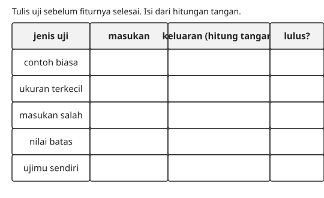

**Ingat dulu:** Tanpa melihat catatan, jawab. (1) Apa saja bagian dokumen rancangan proyek, dan mengapa ada prediksi hasil sebelum program ditulis? ______ (2) Mengapa `m[x]` pada `map` bisa menambah kunci, dan kapan itu masalah? ______

`[Gambar: tabel lima baris jenis uji (contoh biasa, ukuran terkecil, masukan salah, nilai batas, ujimu sendiri) dengan kolom masukan, keluaran hasil hitung tangan, dan lulus, kosong untuk kamu isi.]`

**Prediksi:** Tulis uji sebelum fiturnya selesai, dengan keluaran yang kamu hitung dengan tangan. Isi tabel rencana uji di gambar untuk proyekmu sendiri. Satu uji sengaja digagalkan: bagaimana kamu memastikan ujimu benar-benar menangkap galat? ______

**Latihan:** Pada program Peta Kurir Kampung di modul:

1. `AI: boleh` Tambahkan uji keenam untuk perintah `B` dengan bobot `0` dan tuliskan keluaran yang diharapkan. ______
2. `AI: tanpa AI` Mengapa `d` pada `jarak` bertipe `long long`, padahal tiap bobot paling besar `10^4`? ______
3. `AI: boleh` Mengapa `getline` diperlukan sesudah `cin >> q`? ______

**Cek diri:**

- [ ] Saya dapat menulis uji sebagai berkas masukan dan keluaran.
- [ ] Saya dapat menjalankan semua uji dengan satu perintah.
- [ ] Saya dapat menyebut banyak langkah dan batas masukan programku.

**Catatan cetak (untuk guru, tidak dicetak):** satu halaman A4. Modul ini proyek tahap implementasi, jadi bagian Lengkapi dan Susun dilewati karena modul tidak memuat soal setengah jadi atau Parsons. Kunci ada di modul `a-xii2-m12`, bagian "Kunci dan petunjuk". Lembar tidak memuat kolom nama, kelas, tanggal, atau nilai; penandaan kertas diurus guru di sekolah.
