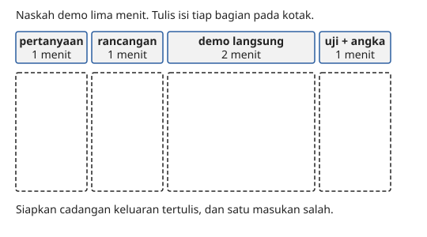

**Ingat dulu:** Tanpa melihat catatan, jawab. (1) Mengapa uji ditulis sebelum fiturnya, dan mengapa sengaja membuat satu uji gagal? ______ (2) Mengapa greedy rasio salah pada knapsack `(6, 30)`, `(5, 20)`, `(5, 20)` dengan kapasitas 10? ______

`[Gambar: batang waktu lima menit terbagi empat bagian: pertanyaan satu menit, rancangan satu menit, demo langsung dua menit, uji dan angka satu menit. Di bawah tiap bagian ada kotak kosong untuk menulis isi naskah demomu.]`

**Lengkapi:** Bahan presentasi adalah dokumen rancangan dan hasil ujimu. Tulis naskah demo lima menit pada kotak di gambar: pertanyaan dan masukan contoh, rancangan (struktur data, strategi, alasannya), demo langsung dari terminal termasuk satu masukan salah, lalu bukti uji dan angka efisiensi. ______

**Latihan:**

1. `AI: boleh` Tulis isi `README.md` untuk proyekmu dalam lima baris: pertanyaan, kompilasi, uji, versi alat, dan batas masukan. ______
2. `AI: tanpa AI` Dari angka `n = 100000` dan `(n + m) log2 n = 4.982.759` pada tabel angka proyek contoh, berapa kali lebih besar batas atas daripada `relaksasi`, dan mengapa selisih itu tidak boleh dijadikan klaim umum? ______
3. `AI: boleh` Rancang satu masukan salah untuk demomu yang ditolak dengan pesan jelas. ______

**Cek diri:**

- [ ] Saya dapat mendemonstrasikan programku dalam lima menit.
- [ ] Saya dapat menunjukkan angka bukti dari programku beserta batasnya.
- [ ] Saya sudah menulis refleksi proyek.

**Catatan cetak (untuk guru, tidak dicetak):** satu halaman A4. Modul ini proyek tahap presentasi dan portofolio, jadi bagian Prediksi dan Susun dilewati karena modul tidak memuat soal prediksi atau Parsons. Kunci ada di modul `a-xii2-m13`, bagian "Kunci dan petunjuk". Lembar tidak memuat kolom nama, kelas, tanggal, atau nilai; penandaan kertas diurus guru di sekolah.
