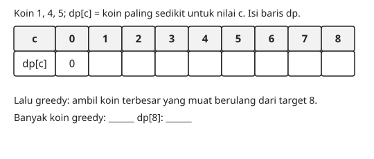

**Ingat dulu:** Ini inti asesmen. Tanpa melihat catatan, jawab. (1) Mengapa pencarian lengkap `2^n` layak untuk `n = 20` tetapi tidak untuk `n = 40`? ______ (2) Bagaimana memperkirakan dari batas masukan bahwa solusi `O(n^2)` tak layak untuk `n = 2 * 10^5`? ______ (3) Apa tiga hal yang dicatat sesudah kontes mini untuk tiap soal? ______



`[Gambar: tabel dengan c dari 0 sampai 8 dan baris dp[c] kosong kecuali dp[0] = 0, untuk menelusuri DP koin paling sedikit dengan koin 1, 4, 5; di bawahnya isian banyak koin greedy dan dp[8].]`

**Latihan:** Kerjakan sendiri, `AI: tanpa AI`, dengan waktu yang ditetapkan gurumu.

1. **Tulis.** Tulis pseudocode lalu program: ada `n` pesanan dengan waktu memasak `t[i]`, dilayani satu per satu. Hitung jumlah waktu tunggu (waktu sebelum pesanan mulai dimasak) bila urutan dipilih sehingga jumlah itu sekecil mungkin. ______
2. **Telusuri.** Sebuah program menghitung `dp[c]`, koin paling sedikit untuk nilai `c` dari 0 sampai 8 dengan koin `1, 4, 5`, lalu menghitung banyak koin cara greedy (koin terbesar yang muat, berulang) untuk target 8. Isi tabel di gambar. Apa arti banyak koin greedy dibanding `dp[8]`? ______
3. **Cari galat.** Tiga potongan berikut sengaja salah. Untuk tiap potongan tulis galatnya, akibatnya, dan perbaikannya. ______

   ```cpp setengah-jadi
   (a) int koin[] = {1, 4, 5};  int sisa = 8, banyak = 0;
       for (int k = 2; k >= 0; k--) while (sisa >= koin[k]) { sisa -= koin[k]; banyak++; }
       // diklaim "paling sedikit koin" untuk semua nilai target
   (b) int n = 200000;  int pasangan = n * (n - 1) / 2;  // banyak pasangan kupon
   (c) map<string, int> stok;  if (stok["pensil"] > 0) { /* cek apakah ada */ }
   ```

4. **Memilih.** Pilih strategi atau struktur data, dengan perkiraan langkah: (a) `10^5` data stok dengan kueri jumlah rentang dan koreksi nilai; (b) `22` barang, pilih himpunan terbaik di bawah kapasitas `10^9`; (c) `10^5` kegiatan berwaktu mulai dan selesai, pilih sebanyak mungkin yang tak bertabrakan. ______

**Cek diri:**

- [ ] Saya dapat memilih greedy, DP, atau pencarian lengkap dengan alasan.
- [ ] Saya dapat menelusuri program kecil dan menemukan galatnya.
- [ ] Saya dapat menulis uji tepi dan menghitung hasilnya dengan tangan.

**Catatan cetak (untuk guru, tidak dicetak):** satu halaman A4. Modul ini asesmen, jadi bagian Prediksi, Lengkapi, dan Susun dilewati karena modul tidak memuatnya. Kunci ada di modul `a-xii2-m14`, bagian "Kunci dan petunjuk". Lembar tidak memuat kolom nama, kelas, tanggal, atau nilai; penandaan kertas diurus guru di sekolah.
