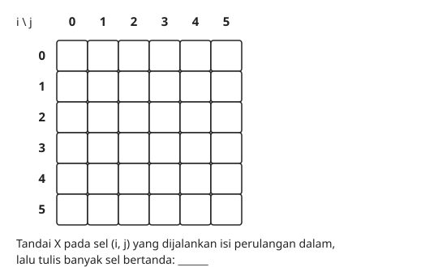

**Ingat dulu:** Tanpa melihat catatan, jawab. (1) Mengapa refaktor harus didahului uji yang merekam keluaran program lama? ______ (2) Mengapa `-17 % 5` bernilai `-2` di C++, dan bagaimana mendapat sisa di `0` sampai `4`? ______



`[Gambar: kisi kosong enam baris i dan enam kolom j (0 sampai 5). Tandai sel (i, j) yang dijalankan isi perulangan dalam, lalu tulis banyak sel bertanda.]`

**Prediksi:** Tebak dulu, tulis, baru periksa. Perulangan bersarang berikut menghitung berapa kali isi perulangan dalam dijalankan, dengan `n = 6`: untuk `i` dari 0 sampai di bawah `n`, untuk `j` dari `i + 1` sampai di bawah `n`, tambah satu `langkah`. Tandai kisi di gambar dan tulis berapa yang tercetak. ______ Tebak rumus umumnya dalam `n`, lalu perkirakan hasilnya untuk `n = 2000`. ______

**Lengkapi:** Isi bagian versi cepat.

```cpp setengah-jadi
  vector<long long> frek(____ + 1, 0);
  for (int x : a) {
    langkah++;
    frek[____]++;
  }
  // ... untuk nilai v yang sama dengan target - v:
  pasangan += frek[v] * (frek[v] - ____) / ____;
```

**Susun:** Urutkan tujuh baris berikut (tanpa lekuk) menjadi perulangan kedua fungsi `cepat`. `AI: tanpa AI`

```text
(a) }
(b) int w = target - v;
(c) if (w < v || w > NILAI_MAKS) {
(d) continue;
(e) }
(f) for (int v = 0; v <= NILAI_MAKS; v++) {
(g) langkah++;
```

Urutan: ______

**Latihan:**

1. `AI: tanpa AI` Untuk `n = 10^5` dan `NILAI_MAKS = 1000`, perkirakan langkah `lambat` dan `cepat`. Mengapa `pasangan` harus `long long`? ______
2. `AI: boleh` Pilih satu solusi lambat milikmu. Bagian mana yang paling boros, dan bagaimana kamu mengukurnya dengan penghitung langkah? ______
3. `AI: boleh` Hitung banyak pasangan indeks `i < j` dengan `(a[i] + a[j])` habis dibagi 7, untuk `n` sampai `10^5` dan nilai sampai `10^9`. Tulis pseudocode. Uji apa yang kamu pilih? ______
4. `AI: boleh` Nilai pada nomor 3 bisa negatif. Mengapa `x % 7` saja tidak cukup, dan apa perbaikannya? ______

**Cek diri:**

- [ ] Saya dapat memasang penghitung langkah dan membaca hasilnya.
- [ ] Saya menulis uji pembanding berbenih tetap sebelum mengganti solusi.
- [ ] Saya dapat menyebut harga yang dibayar sebuah optimasi.

**Catatan cetak (untuk guru, tidak dicetak):** satu halaman A4. Kunci ada di modul `a-xii2-m2`, bagian "Kunci dan petunjuk". Lembar tidak memuat kolom nama, kelas, tanggal, atau nilai; penandaan kertas diurus guru di sekolah.
