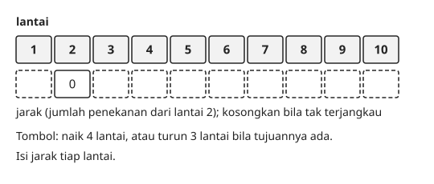

**Ingat dulu:** Tanpa melihat catatan, jawab. (1) Mengapa BFS pada graf tak berbobot menemukan jarak terpendek? ______ (2) Kapan Fenwick lebih cocok daripada larik jumlah prefiks biasa? ______



`[Gambar: sepuluh kotak lantai 1 sampai 10 berjajar, di bawah tiap kotak ada kotak jarak kosong; lantai 2 sudah berisi 0. Tombol: naik 4 lantai atau turun 3 lantai bila tujuannya ada.]`

**Prediksi:** Tebak dulu, tulis, baru periksa. Lift di gedung 10 lantai punya dua tombol: naik 4 lantai atau turun 3 lantai (hanya bila lantai tujuannya ada). Berapa penekanan minimum dari lantai 2 ke lantai 10, dan ke lantai 3? Isi baris jarak pada gambar. ______ Apa yang menjadi simpul dan apa yang menjadi sisi? ______

**Lengkapi:** Isi lembar pemodelan untuk soal: sebuah toko memberi `n` hari, tiap hari boleh dipilih satu tugas bernilai `v[i]`, dan dua hari berurutan tak boleh dipilih keduanya. Maksimalkan jumlah nilai.

```text
Keadaan     : ____
Transisi    : terbaik[i] = max(____, v[i] + ____)
Pertanyaan  : ____
Alat        : ____ karena ____
Batas       : sekitar ____ langkah
Uji kecil   : ____
```

**Susun:** Urutkan lima langkah memodelkan berikut menjadi urutan yang benar. `AI: tanpa AI`

```text
(a) uji model dengan penyelesaian paksa pada ukuran kecil
(b) tentukan apa yang berubah (keadaan)
(c) tulis alat, alasan, dan perkiraan langkah
(d) tentukan perpindahan antarkeadaan (transisi)
(e) tulis pertanyaan yang diminta soal
```

Urutan: ______

**Latihan:** Untuk tiap soal tulis lembar pemodelan lebih dulu.

1. `AI: boleh` Desa punya `n` rumah dan `m` jalan setapak dua arah. Kabar menyebar dari rumah ke tetangga langsung. Berapa kelompok rumah yang kabarnya tak pernah sampai ke kelompok lain? ______
2. `AI: tanpa AI` Mulai dari 1; tiap langkah boleh mengalikan dua atau menambah tiga. Berapa langkah minimum mencapai `N`? Hitung dengan tangan untuk `N = 10` dan `N = 13`. ______
3. `AI: boleh` Tangga `n` anak tangga, tiap langkah naik 1 atau 3 anak tangga, dan beberapa anak tangga rusak tak boleh diinjak. Hitung banyak cara mencapai anak tangga `n` dari tanah. ______
4. `AI: tanpa AI` Pada soal lift, bagaimana bila tiap tombol punya biaya listrik berbeda? Apa yang berubah pada alatnya? ______

**Cek diri:**

- [ ] Saya dapat menyebut keadaan, transisi, dan pertanyaan sebuah soal cerita.
- [ ] Saya dapat memutuskan graf atau DP dan menyebut alasannya.
- [ ] Saya dapat menguji model dengan penyelesaian paksa.

**Catatan cetak (untuk guru, tidak dicetak):** satu halaman A4. Kunci ada di modul `a-xii2-m3`, bagian "Kunci dan petunjuk". Lembar tidak memuat kolom nama, kelas, tanggal, atau nilai; penandaan kertas diurus guru di sekolah.
