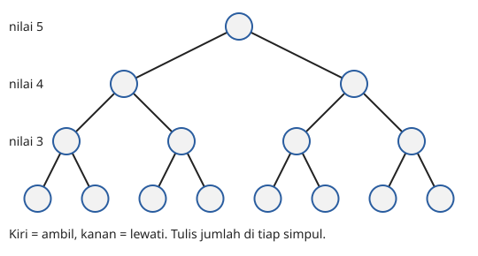

**Ingat dulu:** Tanpa melihat catatan, jawab. (1) Apa empat pertanyaan yang dijawab saat memodelkan soal cerita, dan kapan memilih graf, kapan DP? ______ (2) Sebutkan tiga kasus pada kueri rekursif segment tree. ______



`[Gambar: pohon biner lengkap empat tingkat untuk tiga nilai 5, 4, 3; cabang kiri berarti ambil dan cabang kanan berarti lewati. Tiap simpul berupa lingkaran kosong untuk menulis jumlah sampai simpul itu.]`

**Prediksi:** Tebak dulu, tulis, baru periksa. Program menjelajah pohon "ambil atau lewati" untuk nilai `5 4 3` dengan target 5, dan menghitung simpul yang dikunjungi, tanpa pangkas lalu dengan pangkas (hentikan cabang bila jumlah sudah melebihi target). Isi jumlah tiap simpul pada gambar. Berapa simpul tanpa pangkas, dan mengapa angkanya `2^(n+1) - 1`? ______ Lebih sedikit atau sama banyak simpul dengan pangkas, dan berapa? Silangi simpul yang tak dikunjungi. ______

**Lengkapi:** Isi pangkasan pada pencarian yang mengisi empat kotak dengan angka 1..9 berbeda yang berjumlah 20, dengan batasan: dua kotak bersebelahan tak boleh berselisih tepat 1.

```cpp setengah-jadi
  for (int v = 1; v <= 9; v++) {
    if (dipakai[v]) {
      continue;
    }
    if (pos > 0 && abs(v - kotak[____]) == ____) {
      continue;
    }
    if (pangkas && jumlah + v > ____) {
      continue;
    }
    dipakai[v] = true;
    kotak[pos] = v;
    isi(pos + 1, jumlah + v, pangkas);
    dipakai[v] = ____;
  }
```

**Susun:** Urutkan enam baris berikut (tanpa lekuk) menjadi satu langkah pilih-jelajahi-batalkan di dalam perulangan. `AI: tanpa AI`

```text
(a) isi(pos + 1, jumlah + v);
(b) dipakai[v] = false;
(c) dipakai[v] = true;
(d) kotak[pos] = v;
(e) if (dipakai[v]) continue;
(f) if (jumlah + v > 20) continue;
```

Urutan: ______

**Latihan:**

1. `AI: tanpa AI` Berapa simpul pohon "ambil atau lewati" untuk `n = 4` tanpa pangkas, dan berapa untuk `n = 10`? ______
2. `AI: boleh` Tulis pseudocode soal empat kotak. Bandingkan banyak simpul dengan dan tanpa pangkas jumlah. ______
3. `AI: boleh` Tambahkan pangkas "sisa tak cukup": jumlah sekarang ditambah angka terbesar yang mungkin untuk kotak yang tersisa tak mencapai 20. Apakah jawabannya berubah, dan mengapa? ______
4. `AI: boleh` Pada subset-sum, kapan mengurutkan menurun tidak membantu? Beri satu contoh data. ______

**Cek diri:**

- [ ] Saya dapat menghitung banyak simpul pohon pencarian dengan dan tanpa pangkas.
- [ ] Saya dapat menulis pola pilih, jelajahi, batalkan dengan benar.
- [ ] Saya dapat menyebut mengapa urutan pilihan mengubah simpul tetapi tidak jawaban.

**Catatan cetak (untuk guru, tidak dicetak):** satu halaman A4. Kunci ada di modul `a-xii2-m4`, bagian "Kunci dan petunjuk". Lembar tidak memuat kolom nama, kelas, tanggal, atau nilai; penandaan kertas diurus guru di sekolah.
