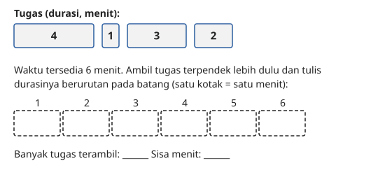

**Ingat dulu:** Tanpa melihat catatan, jawab. (1) Sebutkan tiga cara memangkas ruang pencarian dan syarat agar pangkasan itu aman. ______ (2) Apa saja enam isi satu baris catatan optimasi? ______



`[Gambar: empat kartu tugas berdurasi 4, 1, 3, dan 2 menit, dan batang waktu enam kotak bernomor menit 1 sampai 6 yang kosong untuk menempatkan tugas, dengan isian banyak tugas terambil dan sisa menit.]`

**Prediksi:** Tebak dulu, tulis, baru periksa. Empat tugas berdurasi `4 1 3 2` menit dan tersedia 6 menit. Program mengurutkan durasi lalu mengambil tugas terpendek lebih dulu, berhenti bila tugas berikutnya tidak muat. Isi batang pada gambar. Berapa tugas yang terambil dan berapa menit tersisa? ______ Apakah ada cara mengambil lebih banyak tugas? Jelaskan. ______

**Lengkapi:** Isi program Soal A (`n` tugas berdurasi `d_i`, total waktu `T`; berapa tugas paling banyak yang selesai).

```cpp setengah-jadi
  sort(durasi.begin(), durasi.end());
  int banyak = 0;
  for (int d : durasi) {
    if (d > ____) {
      break;
    }
    total ____ d;
    banyak____;
  }
```

**Susun:** Urutkan enam baris berikut (tanpa lekuk) menjadi inti DP knapsack. `AI: tanpa AI`

```text
(a) for (int i = 0; i < n; i++) {
(b) }
(c) dp[w] = max(dp[w], dp[w - d[i]] + v[i]);
(d) vector<int> dp(batas + 1, 0);
(e) }
(f) for (int w = batas; w >= d[i]; w--) {
```

Urutan: ______

**Latihan:** Semua soal `AI: tanpa AI`. Tulis catatan penyelesaian untuk tiap soal. Soal karangan; data fiktif.

1. **Antrean loket.** `n` pelanggan, pelanggan ke-`i` butuh `t_i` menit. Urutkan agar jumlah waktu tunggu semua pelanggan (sebelum dilayani) minimum, lalu cetak jumlah itu. Batasan: `n <= 10^5`, `t_i <= 10^4`. Contoh: masukan `5` dan `4 2 7 1 3` memberi `20`. ______
2. **Lorong dengan satu pukulan.** Peta `r x c` berisi `S` (awal), `T` (tujuan), `.` (kosong), `#` (dinding). Bergerak empat arah. Kamu boleh menembus paling banyak satu dinding. Cetak langkah minimum, atau `-1`. Batasan: `r, c <= 500`. ______
3. **Cara membayar.** Koin bernilai 1, 2, dan 5 tersedia tak terbatas. Berapa cara membayar `n` (urutan koin tak diperhitungkan)? Batasan: `n <= 1000`. Contoh: `10` memberi `10`. ______
4. **Catatan harga.** `q` perintah: `T x` menambah harga `x`; `H` menghapus harga terkecil; `B` mencetak harga terbesar atau `kosong`. Batasan: `q <= 10^5`. ______

**Cek diri:**

- [ ] Saya dapat memperkirakan langkah dari batas soal.
- [ ] Saya dapat mencari contoh kecil yang mematahkan sebuah greedy.
- [ ] Saya menulis catatan penyelesaian lima baris untuk tiap soal.

**Catatan cetak (untuk guru, tidak dicetak):** satu halaman A4. Kunci ada di modul `a-xii2-m5`, bagian "Kunci dan petunjuk". Lembar tidak memuat kolom nama, kelas, tanggal, atau nilai; penandaan kertas diurus guru di sekolah.
