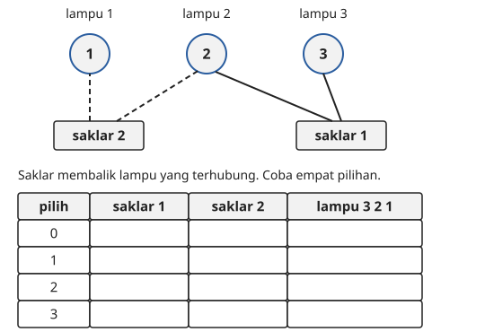

**Ingat dulu:** Tanpa melihat catatan, jawab. (1) Apa lima langkah memilih strategi dari batas soal? ______ (2) Apa beda galat `undefined reference` dan `multiple definition`? ______



`[Gambar: tiga lampu bernomor 1 sampai 3. Saklar 1 (garis penuh) terhubung ke lampu 2 dan 3; saklar 2 (garis putus-putus) terhubung ke lampu 1 dan 2. Di bawahnya tabel pilih 0 sampai 3 dengan kolom saklar 1, saklar 2, dan keadaan lampu 3 2 1, kosong untuk kamu isi.]`

**Prediksi:** Tebak dulu, tulis, baru periksa. Tiga lampu mati dan dua saklar seperti pada gambar; keadaan dicetak sebagai tiga bit dari lampu 3 ke lampu 1. Program mencoba semua pilihan "tekan atau tidak" untuk kedua saklar. Isi tabel: saklar mana yang ditekan pada tiap pilihan (`pilih` dibaca bitnya, bit ke-`s` untuk saklar `s + 1`) dan keadaan lampu. ______ Berapa pilihan yang dicoba untuk `m` saklar, dan mengapa tiap saklar cukup ditekan paling banyak sekali? ______

**Lengkapi:** Isi solusi linear untuk jumlah ruas terbesar sebuah larik `a` (bilangan boleh negatif): simpan jumlah terbaik yang berakhir di posisi sekarang.

```cpp setengah-jadi
  long long berakhirDi = ____;
  for (int x : a) {
    berakhirDi = max(static_cast<long long>(x), berakhirDi + ____);
    terbaik = max(terbaik, ____);
  }
```

**Susun:** Urutkan enam baris berikut (tanpa lekuk) menjadi inti soal B (harga tiket). `AI: tanpa AI`

```text
(a) for (int p : harga) {
(b) untung = max(untung, p - termurah);
(c) termurah = min(termurah, p);
(d) }
(e) int termurah = harga[0];
(f) int untung = 0;
```

Urutan: ______

**Latihan:** Tiga soal kontes, semua `AI: tanpa AI`. Soal karangan; data fiktif.

1. **A, Pagar warna.** Satu baris string berhuruf `M`, `K`, `B` (panjang paling banyak `10^5`). Cetak panjang deret huruf sama berturut-turut terpanjang. Contoh: `MMKKKBMMMMK` memberi `4`. ______
2. **B, Harga tiket.** `n` hari (paling banyak `10^5`) dengan harga `p_i` (paling banyak `10^9`). Beli di hari `i`, jual di hari `j > i`. Cetak keuntungan terbesar, atau `0` bila tak mungkin untung. ______
3. **C, Lampu taman.** `n` lampu (paling banyak 15), awalnya mati, dan `m` saklar (paling banyak 15). Tiap saklar menyebut lampu yang dibaliknya. Cetak penekanan minimum agar semua lampu menyala, atau `-1`. ______
4. **Rencana.** Sebelum mengerjakan, tulis pembagian menit sendiri dan perkiraan langkah tiap soal. ______

**Cek diri:**

- [ ] Saya dapat menyusun pembagian waktu untuk tiga soal.
- [ ] Saya dapat mengambil subtugas lebih dulu lalu memperbaikinya.
- [ ] Saya menulis catatan tiga baris untuk tiap soal.

**Catatan cetak (untuk guru, tidak dicetak):** satu halaman A4. Modul ini kontes mini kelas, bukan kompetisi. Kunci ada di modul `a-xii2-m6`, bagian "Kunci dan petunjuk". Lembar tidak memuat kolom nama, kelas, tanggal, atau nilai; penandaan kertas diurus guru di sekolah.
