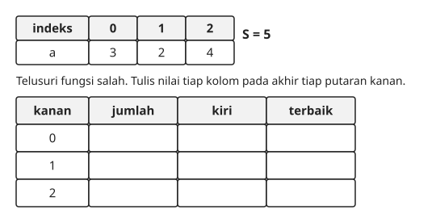

**Ingat dulu:** Tanpa melihat catatan, jawab. (1) Mengapa pangkasan tidak boleh mengubah jawaban, dan bagaimana membuktikannya pada sebuah program? ______ (2) Apa saja isi laporan proyek program yang lengkap? ______



`[Gambar: larik a berindeks 0 sampai 2 berisi 3, 2, 4 dengan S = 5, dan tabel penelusuran dengan kolom kanan, jumlah, kiri, terbaik; tiga baris kosong untuk kamu isi.]`

**Prediksi:** Tebak dulu, tulis, baru periksa. Fungsi ini mencari panjang ruas terpanjang bilangan positif dengan jumlah **paling banyak** `S`, memakai dua penunjuk.

```cpp
#include <algorithm>
#include <vector>
using namespace std;
int salah(const vector<int>& a, int S) {
  int n = static_cast<int>(a.size());
  int kiri = 0;
  int jumlah = 0;
  int terbaik = 0;
  for (int kanan = 0; kanan < n; kanan++) {
    jumlah += a[kanan];
    while (jumlah >= S) {
      jumlah -= a[kiri];
      kiri++;
    }
    terbaik = max(terbaik, kanan - kiri + 1);
  }
  return terbaik;
}
```

Telusuri `salah({3, 2, 4}, 5)` dengan tabel di gambar. Apa yang dikembalikan? ______ Berapa jawaban yang sebenarnya, dan di baris mana kamu mencurigai sebabnya? ______

**Lengkapi:** Isi pencari masukan terkecil yang membuat `salah` berbeda dari penyelesaian paksa.

```cpp setengah-jadi
  for (int n = 1; n <= ____ && !ketemu; n++) {
    for (int nomor = 0; nomor < total && !____; nomor++) {
      vector<int> a = larikKe(n, nomor);
      if (salah(a, S) ____ paksa(a, S)) {
        ketemu = true;
      }
    }
  }
```

**Susun:** Urutkan lima langkah berikut menjadi empat langkah analisis galat ditambah satu langkah lanjutan. `AI: tanpa AI`

```text
(a) perbaiki sebabnya dan jadikan masukan itu uji tetap
(b) temukan masukan terkecil yang gagal
(c) bandingkan dengan solusi paksa yang pasti benar
(d) cari baris dan sebabnya, lalu golongkan galatnya
(e) selesaikan ulang sendiri sesudah jeda
```

Urutan: ______

**Latihan:** Semua soal `AI: tanpa AI`. Untuk tiap potongan kode: temukan masukan terkecil yang membuatnya salah, golongkan galatnya, dan perbaiki.

1. Kode ini seharusnya menjumlahkan kuadrat bilangan (tiap bilangan paling banyak `10^5`). ______

   ```cpp
   #include <vector>
   using namespace std;
   int jumlahKuadrat(const vector<int>& a) {
     int total = 0;
     for (int x : a) {
       total += x * x;
     }
     return total;
   }
   ```

2. Fungsi ini seharusnya mengembalikan indeks pertama yang nilainya tidak kurang dari `x` pada larik terurut, atau banyak elemen bila tak ada. ______

   ```cpp
   #include <vector>
   using namespace std;
   int pertamaTidakKurang(const vector<int>& a, int x) {
     int lo = 0;
     int hi = static_cast<int>(a.size()) - 1;
     while (lo < hi) {
       int mid = (lo + hi) / 2;
       if (a[mid] < x) {
         lo = mid + 1;
       } else {
         hi = mid;
       }
     }
     return lo;
   }
   ```

3. Ambil satu jawaban yang salah atau kurang dari kontes mini `a-xii2-m6`, dan tulis satu baris catatan analisis galat enam kolom beserta perbaikannya. ______

**Cek diri:**

- [ ] Saya dapat menyebut empat langkah analisis galat.
- [ ] Saya dapat mencari masukan terkecil yang gagal dengan pembanding paksa.
- [ ] Saya menulis uji tetap untuk tiap galat yang kuperbaiki.

**Catatan cetak (untuk guru, tidak dicetak):** satu halaman A4, dapat dua halaman bila kode diperbesar. Kunci ada di modul `a-xii2-m7`, bagian "Kunci dan petunjuk". Lembar tidak memuat kolom nama, kelas, tanggal, atau nilai; penandaan kertas diurus guru di sekolah.
