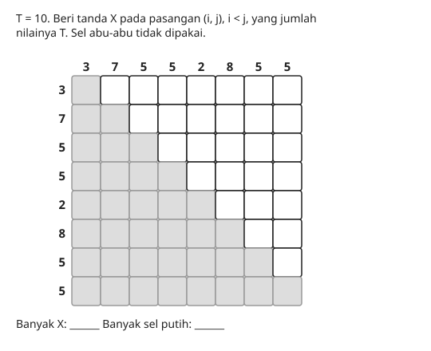

**Ingat dulu:** Tanpa melihat catatan, jawab. (1) Apa empat langkah menganalisis jawaban yang salah? ______ (2) Mengapa greedy menurut rasio nilai per berat bisa gagal pada soal knapsack? Beri contoh. ______



`[Gambar: kisi delapan kali delapan dengan baris dan kolom berlabel nilai kupon 3, 7, 5, 5, 2, 8, 5, 5. Hanya sel dengan baris di atas kolom (i lebih kecil dari j) yang putih, sel lain abu-abu. Tandai pasangan yang jumlahnya T = 10 dan tulis banyak tanda dan banyak sel putih.]`

**Prediksi:** Tebak dulu, tulis, baru periksa. Soal "Kupon Gabungan": ada `n` kupon bernilai `a[i]`; hitung banyak pasangan `(i, j)` dengan `i < j` dan `a[i] + a[j] = T`. Pasangan dihitung menurut posisi, jadi dua kupon bernilai 5 di posisi berbeda dihitung sebagai pasangan sendiri. Untuk kupon di gambar dan `T = 10`: berapa pasangan, dan berapa pemeriksaan oleh dua perulangan bersarang? ______ Bila `a` berisi dua juta kupon, apakah cara ini masih layak? Perkirakan banyak perbandingannya. ______

**Lengkapi:** Isi dua tempat agar program menghitung pasangan dengan cara B langsung saat membaca (satu lintasan tanpa menyimpan larik): yang dicari adalah pasangan yang sudah terlihat, lalu nilai sekarang dicatat.

```cpp setengah-jadi
#include <iostream>
#include <map>
using namespace std;
int main() {
  int n;
  int T;
  cin >> n >> T;
  map<int, long long> banyak;
  long long hasil = 0;
  for (int i = 0; i < n; i++) {
    int x;
    cin >> x;
    hasil += banyak[____];
    banyak[____]++;
  }
  cout << hasil << "\n";
}
```

**Susun:** Urutkan baris berikut menjadi fungsi `hitungA` yang benar (kerangka `#include` dan `main` sudah ada). Indentasi pada daftar sudah menunjukkan tingkat tiap baris di jawaban akhir. `AI: tanpa AI`

```text
      }
  return pasangan;
  long long pasangan = 0;
    for (size_t j = i + 1; j < a.size(); j++) {
      if (a[i] + a[j] == T) {
long long hitungA(const vector<int>& a, int T) {
        pasangan++;
  for (size_t i = 0; i < a.size(); i++) {
      }
    }
}
```

Urutan (tulis nomor baris dari atas ke bawah): ______

**Latihan:** Kerjakan sendiri, tanpa AI.

1. `AI: tanpa AI` Tulis solusi C untuk Kupon Gabungan: urutkan, lalu dua penunjuk dari ujung. Bagaimana kamu menangani nilai kembar, dan berapa langkahnya? ______
2. `AI: tanpa AI` Untuk `n = 200000` dan semua kupon bernilai 5 dengan `T = 10`, berapa jawabannya? Apa yang terjadi bila jawaban disimpan di `int`? ______
3. `AI: tanpa AI` Soal "banyak nilai berbeda" dalam `n` bilangan: tulis dua solusi (loop ganda dan urutkan lalu hitung perubahan nilai) dan jalankan pada `7` bilangan `4 9 4 1 9 9 2`. ______
4. `AI: tanpa AI` Buat laporan alternatif satu halaman untuk soal nomor 3 dengan keempat bagiannya. ______

**Cek diri:**

- [ ] Saya menulis batasan dan perkiraan langkah sebelum memilih cara.
- [ ] Saya menulis dua solusi berbeda untuk satu soal.
- [ ] Saya memilih solusi dengan alasan langkah, memori, dan luapan.

**Catatan cetak (untuk guru, tidak dicetak):** satu halaman A4. Kunci ada di modul `a-xii2-m8`, bagian "Kunci dan petunjuk". Lembar tidak memuat kolom nama, kelas, tanggal, atau nilai; penandaan kertas diurus guru di sekolah.
