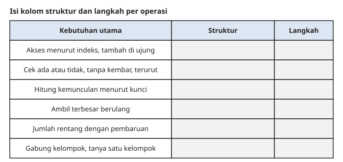

**Ingat dulu:** Tanpa melihat catatan, jawab. (1) Apa saja isi laporan alternatif, dan mengapa dua solusi dibandingkan lebih dulu pada masukan kecil? (2) Bagaimana penghitung langkah menunjukkan bahwa solusi linear mengungguli solusi kuadrat dan kubik? (3) Apa beda refaktor dan memperbaiki galat?

1. ______
2. ______
3. ______



`[Gambar: tabel tiga kolom: kebutuhan utama, struktur, langkah. Enam kebutuhan sudah tertulis: akses menurut indeks dan tambah di ujung, cek ada atau tidak tanpa kembar terurut, hitung kemunculan menurut kunci, ambil terbesar berulang, jumlah rentang dengan pembaruan, gabung kelompok dan tanya satu kelompok. Kolom struktur dan langkah kosong; isi dengan struktur dan banyak langkah per operasi.]`

**Prediksi:** Tebak dulu, tulis, baru jalankan. Lima bilangan yang sama dimasukkan ke tiga struktur berbeda.

```cpp
#include <iostream>
#include <map>
#include <queue>
#include <set>
using namespace std;

int main() {
  int data[] = {4, 1, 4, 3, 1};
  set<int> s;
  priority_queue<int> pq;
  map<int, int> m;
  for (int x : data) {
    s.insert(x);
    pq.push(x);
    m[x]++;
  }
  cout << s.size() << " " << pq.size() << " " << m.size() << "\n";
  cout << *s.begin() << " " << pq.top() << " " << m[4] << "\n";
  pq.pop();
  pq.pop();
  cout << pq.top() << "\n";
}
```

Tiga baris yang tercetak:

1. ______
2. ______
3. ______

Mengapa ukuran `set`, `priority_queue`, dan `map` tidak sama? ______

**Lengkapi:** Program mencetak nilai terbesar ke-`k` dan jumlah `k` nilai terbesar dengan heap berukuran `k`. Isi dua tempat kosong.

```cpp setengah-jadi
#include <iostream>
#include <queue>
#include <vector>
using namespace std;

int main() {
  int n;
  int k;
  cin >> n >> k;
  priority_queue<int, vector<int>, ______> pq;
  long long jumlah = 0;
  for (int i = 0; i < n; i++) {
    int x;
    cin >> x;
    pq.push(x);
    jumlah += x;
    if ((int)pq.size() > ______) {
      jumlah -= pq.top();
      pq.pop();
    }
  }
  cout << pq.top() << " " << jumlah << "\n";
}
```

**Susun:** `AI: tanpa AI`. Susun baris menjadi isi `main` yang mencetak nilai yang paling sering muncul dan banyak kemunculannya (bila seri, pilih nilai terkecil). Tulis urutan hurufnya.

```text
A. cout << terbaik << " " << paling << "\n";
B.     paling = jumlah;
C.   banyak[x]++;
D. map<int, int> banyak;
E. int paling = 0;
F.     terbaik = kunci;
G.   }
H. for (auto& [kunci, jumlah] : banyak) {
I.   if (jumlah > paling) {
J. for (int x : data) {
K. }
L. int terbaik = -1;
M. }
```

Urutan: ______

**Latihan:**

1. `AI: boleh` Antrean layanan: tiket bertingkat darurat 1 sampai 3, dilayani dari tingkat tertinggi, dan tiket seimbang menurut nomor terkecil. Pilih struktur dan tulis programnya untuk masukan `5` tiket bertingkat `2 1 3 3 1`. ______
2. `AI: tanpa AI` Daftar nama dalam kotak masuk: cek cepat apakah sebuah nama sudah terdaftar, dan cetak semua nama terurut. Pilih struktur dan sebut langkah tiap operasi. ______
3. `AI: boleh` Fenwick untuk `n = 10^6` bilangan `long long`: berapa megabita memorinya, dan mengapa `long long` dipilih bila nilai bisa `10^9`? ______
4. `AI: boleh` Sebuah jaringan kabel mulai dari `n` titik terpisah; perintah `G a b` menyambung dua titik dan `T a b` menanyakan apakah terhubung. Pilih struktur dan sebut langkahnya. ______

**Cek diri:**

- [ ] Saya dapat memilih struktur dari operasi yang dibutuhkan, bukan dari kebiasaan.
- [ ] Saya dapat membuktikan pilihan dengan menghitung langkah.
- [ ] Saya dapat menjelaskan mengapa `m[x]` menambah kunci.

**Catatan cetak (untuk guru, tidak dicetak):** dua halaman A4. Kunci ada di modul `a-xii2-m9`, bagian "Kunci dan petunjuk". Lembar tidak memuat kolom nama, kelas, tanggal, atau nilai.
