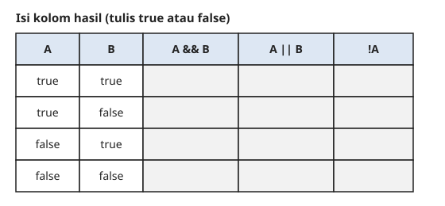

**Ingat dulu:** Tanpa melihat catatan, jawab. (1) Berapa hasil `7 % 3` dan `7 / 2` di JavaScript? (2) Tulis pseudocode untuk mencari nilai terbesar dari tiga bilangan A, B, dan C. (3) Satu bit dapat menyimpan nilai apa saja?

1. ______
2. ______
3. ______



`[Gambar: tabel lima kolom: A, B, A && B, A || B, dan !A. Empat baris kombinasi A dan B (true true, true false, false true, false false) sudah terisi; tiga kolom hasil kosong. Tulis true atau false di tiap sel.]`

**Prediksi:** `AI: tanpa AI`. Baca skrip ini, tebak dulu, tulis jawabanmu per baris, baru jalankan.

```js
// prediksi-genap.js
const angka = 7;
if (angka % 2 === 0) {
  console.log(angka, "genap");
} else {
  console.log(angka, "ganjil");
}
console.log(5 === "5");
console.log(5 === 5);
console.log(true && false, true || false, !true);
const kosong = "";
if (kosong) {
  console.log("ada isi");
} else {
  console.log("kosong");
}
```

Baris yang tercetak, urut:

1. ______
2. ______
3. ______
4. ______
5. ______

Mengapa `5 === "5"` bisa salah, padahal keduanya "lima"? ______

**Lengkapi:** Cetak `positif genap` bila `n` lebih besar dari 0 dan habis dibagi 2, selain itu `bukan`. Isi bagian kosong.

```js setengah-jadi
// pg-setengah.js
const n = Number(Bun.argv[2]);
if (n > 0 ______ n % 2 === ______) {
  console.log("positif genap");
} else {
  console.log("bukan");
}
```

**Susun:** Susun baris (sudah diacak) menjadi skrip yang mencetak `lulus` bila nilai minimal 60 dan `ulang` bila kurang.

```text
(a) } else {
(b)   console.log("ulang");
(c) const nilai = Number(Bun.argv[2]);
(d) if (nilai >= 60) {
(e) }
(f)   console.log("lulus");
```

Urutan: ______

**Latihan:**

1. `AI: tanpa AI` Tanpa menjalankan, tulis `true` atau `false` untuk `a > 5 && b < 3`, `!(a > 5 && b < 3)`, dan `a <= 5 || b >= 3`, dengan `a = 6` dan `b = 4`. Apa yang kamu perhatikan pada hasil kedua dan ketiga? ______
2. `AI: boleh` Tulis pseudocode lalu skrip yang membaca satu bilangan dari argumen dan mencetak `genap` atau `ganjil`. ______
3. `AI: boleh` Tulis skrip dengan empat kategori untuk nilai karangan 0 sampai 100, dan ujilah dengan nilai tepat di batas (misalnya 70 dan 69). ______
4. `AI: tanpa AI` Tulis ulang lebih sederhana: `if (x === true)` dan `if (!(a > 5 && b < 3))` (gunakan `a <= 5 ||`). Jelaskan mengapa hasilnya sama. ______

**Cek diri:**

- [ ] Saya dapat menulis `if`/`else if`/`else` dengan urutan syarat yang benar.
- [ ] Saya selalu memakai `===` untuk membandingkan, bukan `=`.
- [ ] Saya dapat menyebut nilai falsy dan tahu `"0"` bukan falsy.

**Catatan cetak (untuk guru, tidak dicetak):** dua halaman A4. Kunci ada di modul `b-x1-m10`, bagian "Kunci dan petunjuk". Lembar tidak memuat kolom nama, kelas, tanggal, atau nilai.
