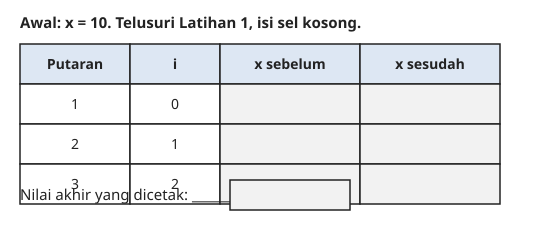

**Ingat dulu:** Tanpa melihat catatan, jawab. (1) Tulis kondisi JavaScript yang benar bila bilangan `n` genap. (2) Apa beda `git add` dan `git commit`? (3) Apa beda `=` dan `===`?

1. ______
2. ______
3. ______



`[Gambar: tabel penelusuran dengan kolom putaran, i, x sebelum, dan x sesudah. Awal x = 10; tiga baris dengan i = 0, 1, 2. Dua kolom x kosong, dan satu kotak kosong untuk nilai akhir yang dicetak. Dipakai pada Latihan 1.]`

**Prediksi:** `AI: tanpa AI`. Baca skrip ini, tebak dulu, tulis jawabanmu, baru jalankan.

```js
// prediksi-for.js
let jumlah = 0;
for (let i = 1; i <= 4; i++) {
  jumlah = jumlah + i;
  console.log("i =", i, "jumlah =", jumlah);
}
console.log("selesai:", jumlah);
```

Berapa kali blok di dalam `for` dijalankan? ______

Isi baris yang tercetak pada tiap putaran: ______

Apa yang tercetak paling akhir, dan mengapa hanya sekali? ______

**Lengkapi:** Hitung jumlah 1 sampai `n` dari argumen; hasil yang benar untuk `bun run jumlah-setengah.js 10` adalah 55. Isi bagian kosong.

```js setengah-jadi
// jumlah-setengah.js
const n = Number(Bun.argv[2]);
let jumlah = ______;
for (let i = ______; i <= n; i++) {
  jumlah = jumlah + ______;
}
console.log("Jumlah 1 sampai", n, "=", jumlah);
```

**Susun:** Susun baris (sudah diacak) menjadi skrip dengan `while` yang mencetak `putaran 1`, `putaran 2`, dan `putaran 3`.

```text
(a)   i = i + 1;
(b) while (i <= 3) {
(c) }
(d) let i = 1;
(e)   console.log("putaran", i);
```

Urutan: ______

**Latihan:**

1. `AI: tanpa AI` Tanpa menjalankan, tulis apa yang tercetak dan nilai akhir `x`. Gunakan tabel pada gambar.

   ```js
   let x = 10;
   for (let i = 0; i < 3; i++) {
     if (i === 1) {
       continue;
     }
     x = x - i;
   }
   console.log(x);
   ```

2. `AI: boleh` Tulis pseudocode lalu skrip yang mencetak jumlah semua bilangan genap dari 2 sampai `n` (`n` dari argumen). Uji dengan `n = 10`. ______
3. `AI: boleh` Tulis skrip yang mencetak tabel perkalian satu bilangan `m` dari argumen untuk 1 sampai 10 (`m x k = hasil`), lalu skrip lain yang mencetak segitiga bintang setinggi `n` dari argumen. ______
4. `AI: boleh` Tulis pseudocode lalu skrip yang mencetak semua bilangan prima dari 2 sampai 30. Bilangan prima adalah bilangan lebih dari 1 yang hanya habis dibagi 1 dan dirinya sendiri; pakai `%` dan `break`. ______

**Cek diri:**

- [ ] Saya dapat menelusuri perulangan dengan tabel nilai variabel.
- [ ] Saya dapat menjelaskan beda `break` dan `continue`.
- [ ] Saya menulis pseudocode sebelum skripnya.

**Catatan cetak (untuk guru, tidak dicetak):** dua halaman A4. Kunci ada di modul `b-x1-m11`, bagian "Kunci dan petunjuk". Lembar tidak memuat kolom nama, kelas, tanggal, atau nilai.
