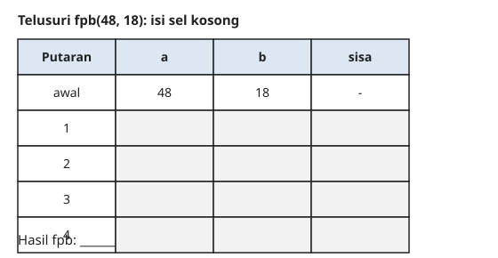

**Ingat dulu:** Tanpa melihat catatan, jawab. (1) Tulis `for` yang mencetak 1 sampai 5; sebutkan tiga bagian di dalam kurungnya. (2) Apa beda `let` dan `const`? (3) Apa hasil `true && false` dan `true || false`?

1. ______
2. ______
3. ______



`[Gambar: tabel penelusuran algoritma Euclid dengan kolom putaran, a, b, dan sisa. Baris awal berisi a = 48 dan b = 18; empat baris putaran 1 sampai 4 kosong. Di bawahnya ada tempat kosong untuk hasil fpb. Dipakai pada Latihan 2.]`

**Prediksi:** `AI: tanpa AI`. Baca skrip ini, tebak dulu, tulis jawabanmu per baris, baru jalankan. Parameter adalah nama di dalam kurung saat fungsi ditulis; argumen adalah nilai saat memanggil.

```js
// prediksi-fungsi.js
function kuadrat(x) {
  return x * x;
}
function sapa(nama) {
  console.log("Halo,", nama);
}
console.log(kuadrat(5));
sapa("Dewi-contoh");
const hasil = sapa("Budi-contoh");
console.log(hasil);
const tambah = (a, b) => a + b;
console.log(tambah(2, 3));
```

Apa yang tercetak pada tiap baris? ______

`sapa` tidak memakai `return`. Apa yang disimpan di `hasil`? ______

**Lengkapi:** Isi bagian kosong agar `rataRata(4, 8, 6)` menghasilkan 6 dan `terbesar2(3, 9)` menghasilkan 9.

```js setengah-jadi
// fungsi-setengah.js
function rataRata(a, b, c) {
  return (______ + ______ + ______) / ______;
}
console.log(rataRata(4, 8, 6));
const terbesar2 = (a, b) => {
  if (a > b) {
    return ______;
  }
  return ______;
};
console.log(terbesar2(3, 9));
```

**Susun:** Susun baris (sudah diacak) menjadi fungsi `jumlahDeret(n)` yang mengembalikan jumlah 1 sampai `n`.

```text
(a)   for (let i = 1; i <= n; i++) {
(b)   return jumlah;
(c) function jumlahDeret(n) {
(d)   }
(e) }
(f)     jumlah = jumlah + i;
(g)   let jumlah = 0;
```

Urutan: ______

**Latihan:**

1. `AI: tanpa AI` Tanpa menjalankan, tulis apa yang tercetak, lalu nilai `a` setelah pemanggilan.

   ```js
   function ubah(x) {
     let y = x + 1;
     x = x * 2;
     return y + x;
   }
   let a = 3;
   console.log(ubah(a));
   console.log(a);
   const dua = (n) => n * 2;
   console.log(dua(dua(3)));
   ```

   Tiga baris tercetak: ______
2. `AI: boleh` Tulis fungsi `fpb(a, b)` dengan algoritma Euclid dan skrip yang membaca dua bilangan dari argumen. Telusuri `fpb(48, 18)` pada tabel di gambar, lalu cocokkan dengan Bun.
3. `AI: boleh` Tulis pseudocode lalu fungsi `faktorial(n)` dan skrip yang membaca `n` dari argumen. Uji dengan 0, 1, 5, dan 10. ______
4. `AI: boleh` Ubah uji prima dari `b-x1-m11` menjadi fungsi `apakahPrima(n)` yang mengembalikan `true` atau `false`, lalu cetak semua bilangan prima dari 1 sampai 30 dengan memanggilnya. ______

**Cek diri:**

- [ ] Saya dapat menjelaskan beda parameter dan argumen.
- [ ] Saya tahu fungsi tanpa `return` mengembalikan `undefined`.
- [ ] Saya dapat memecah skrip menjadi beberapa fungsi kecil dan mengujinya.

**Catatan cetak (untuk guru, tidak dicetak):** dua halaman A4. Kunci ada di modul `b-x1-m12`, bagian "Kunci dan petunjuk". Lembar tidak memuat kolom nama, kelas, tanggal, atau nilai.
