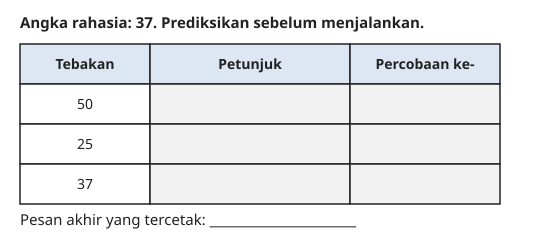

**Ingat dulu:** Tanpa melihat catatan, jawab. (1) Apa yang dikembalikan fungsi yang tidak punya `return`? (2) Apa hasil `5 === "5"`, dan mengapa? (3) Mengapa contoh program latihan memakai nama karangan dan bukan nama atau data temanmu?

1. ______
2. ______
3. ______

`[Gambar: tabel tiga kolom: tebakan, petunjuk, dan percobaan ke-. Angka rahasia 37; tiga baris tebakan 50, 25, dan 37 sudah tertulis, kolom petunjuk dan percobaan kosong. Di bawahnya ada garis kosong untuk pesan akhir. Dipakai pada Prediksi.]`

**Prediksi:** Permainan tebak angka memilih angka rahasia 1 sampai 100 dan pemain boleh menebak maksimal 7 kali. Petunjuk yang mungkin: "terlalu kecil", "terlalu besar", atau "tepat". Dengan angka rahasia 37 dan tebakan 50, 25, lalu 37, tulis petunjuk tiap tebakan dan pesan akhir pada tabel di gambar.

Rencana satu halaman punya enam bagian. Sebut keenamnya dari ingatan: ______

**Latihan:**

1. Tulis skrip yang mencoba semua angka rahasia 1 sampai 100 dan selalu menebak tengah-tengah rentang yang tersisa, lalu cetak tebakan terbanyak yang pernah dibutuhkan. Mengapa 7 kesempatan cukup untuk 100 angka? ______
2. Tulis fungsi `dalamRentang(x, min, maks)` yang mengembalikan `true` bila `x` bilangan bulat di antara `min` dan `maks`, lalu pakai di `tebak.js`. ______
3. Tulis tiga pesan commit Git yang menceritakan tiga tahap pengerjaan proyekmu, lalu periksa dengan `git log --oneline`. ______

**Cek diri:**

- [ ] Saya menulis rencana satu halaman sebelum kode.
- [ ] Saya menguji nilai biasa dan nilai tepat di batas dan mencatat hasilnya.
- [ ] Saya tidak memakai data pribadi di contoh, di uji, maupun di perintah ke AI.

**Catatan cetak (untuk guru, tidak dicetak):** satu halaman A4. Kunci ada di modul `b-x1-m13`, bagian "Kunci dan petunjuk". Modul ini berupa proyek, jadi lembar tidak memuat bagian Lengkapi dan Susun. Lembar tidak memuat kolom nama, kelas, tanggal, atau nilai.
