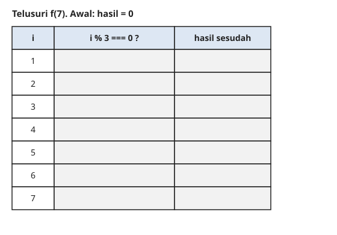

**Ingat dulu:** Jawab dari ingatan, tanpa melihat catatan. (1) Sebutkan tiga bagian siklus I-P-O dan satu contoh perangkat untuk masing-masing. (2) Apa beda `break` dan `continue`? (3) Mengapa kita menguji dengan nilai tepat di batas, misalnya 1 dan 100?

1. ______
2. ______
3. ______



`[Gambar: tabel penelusuran dengan kolom i, "i % 3 === 0 ?", dan "hasil sesudah". Baris i dari 1 sampai 7 sudah tertulis, awal hasil 0; dua kolom lain kosong. Dipakai pada Latihan 1.]`

**Latihan:** Kerjakan sendiri, `AI: tanpa AI`, dalam waktu yang ditetapkan gurumu.

1. `AI: tanpa AI` **Telusuri.** Skrip berikut dijalankan. Apa yang tercetak? Berapa kali kondisi `i % 3 === 0` benar pada `f(7)`? Gunakan tabel pada gambar.

   ```js
   function f(n) {
     let hasil = 0;
     for (let i = 1; i <= n; i++) {
       if (i % 3 === 0) {
         continue;
       }
       hasil = hasil + i;
     }
     return hasil;
   }
   console.log(f(7));
   console.log(f(2));
   ```

   Tercetak: ______  Kondisi benar sebanyak: ______
2. `AI: tanpa AI` **Hitung dan jelaskan.** Tulis apa yang dicetak oleh `console.log("8" + 2, "8" * 2, 8 % 3, 2 ** 5, typeof true, 5 === "5");`, dan jelaskan dua hasil pertama. ______
3. `AI: tanpa AI` **Cari galat.** Potongan berikut sengaja salah. Tulis tiga galat, akibat masing-masing, dan perbaikannya. Apa yang tercetak sebelum diperbaiki?

   ```text
   function rata(a, b) {
     a + b / 2;
   }
   let total = 0;
   for (let i = 1; i <= 3; i++) {
     let total = 0;
     total = total + i;
   }
   console.log(rata(4, 8), total);
   ```

   ______
4. `AI: tanpa AI` **Konsep fondasi.** Urutkan langkah halaman web sampai ke peramban dan tulis urutan hurufnya. A: server mengirim halaman lewat HTTP. B: peramban meminta alamat IP nama situs ke DNS. C: peramban menampilkan halaman. D: DNS menjawab dengan alamat IP. E: peramban meminta halaman ke server pada alamat IP itu. Urutan: ______

**Cek diri:**

- [ ] Saya dapat menelusuri skrip dengan tabel nilai variabel.
- [ ] Saya dapat menjelaskan hasil `"8" + 2` dan `"8" * 2`.
- [ ] Saya dapat menemukan galat `return` yang hilang, urutan operasi, dan `let` yang menutupi variabel.

**Catatan cetak (untuk guru, tidak dicetak):** dua halaman A4. Kunci ada di modul `b-x1-m14`, bagian "Kunci dan petunjuk". Modul ini asesmen, jadi lembar tidak memuat bagian Prediksi, Lengkapi, dan Susun. Lembar tidak memuat kolom nama, kelas, tanggal, atau nilai.
