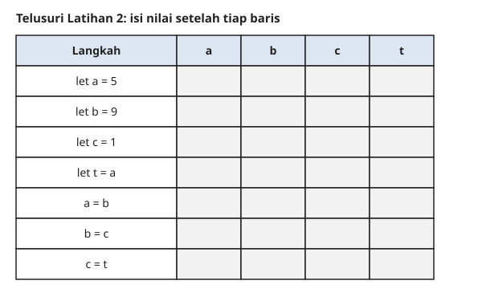

**Ingat dulu:** Tanpa melihat catatan, jawab. (1) Apa yang disimpan memori komputer Von Neumann, selain data? (2) Sebutkan tiga bagian siklus I-P-O dan satu contoh perangkat untuk masing-masing. (3) Beri nama yang lebih baik untuk berkas `Tugas Pertama!!.JS`, tanpa spasi dan karakter khusus.

1. ______
2. ______
3. ______



`[Gambar: tabel penelusuran dengan kolom langkah, a, b, c, dan t. Tujuh baris langkah sudah tertulis: let a = 5, let b = 9, let c = 1, let t = a, a = b, b = c, c = t. Semua sel nilai kosong; tulis nilainya setelah tiap baris. Dipakai pada Latihan 2.]`

**Prediksi:** Baca skrip ini, tebak dulu, tulis jawabanmu, baru jalankan.

```js
// prediksi.js
console.log("Halo");
console.log(2 + 3);
console.log("2 + 3");
console.log("a", "b");
console.log("Jumlah:", 2 + 3);
```

Berapa baris yang tercetak? ______

Mengapa baris kedua dan ketiga bisa berbeda, padahal isinya mirip? ______

Apa yang tercetak antara `a` dan `b`? ______

**Lengkapi:** Tujuannya menukar dua nilai. Isi bagian kosong.

```js setengah-jadi
// tukar-setengah.js
let x = 10;
let y = 25;
let sementara = ______;
x = ______;
y = ______;
console.log(x, y);
```

**Susun:** Susun baris (sudah diacak) menjadi skrip yang mencetak luas persegi panjang dengan panjang 6 dan lebar 4. `*` berarti kali.

```text
(a) console.log("Luas:", luas);
(b) let lebar = 4;
(c) let luas = panjang * lebar;
(d) let panjang = 6;
```

Urutan: ______

**Latihan:**

1. `AI: boleh` Buat skrip yang mencetak tiga baris: salam, nama panggilan karangan, dan nama kelas karangan. Jalankan dan cocokkan dengan tebakanmu. ______
2. `AI: tanpa AI` Skrip berikut dijalankan. Isi tabel pada gambar (nilai `a`, `b`, `c`, dan `t` setelah tiap baris), lalu tulis apa yang tercetak.

   ```js
   let a = 5;
   let b = 9;
   let c = 1;
   let t = a;
   a = b;
   b = c;
   c = t;
   console.log(a, b, c);
   ```

   Tercetak: ______
3. `AI: boleh` Tulis pseudocode untuk mencari nilai terbesar dari empat bilangan A, B, C, dan D. Telusuri dengan A = 2, B = 7, C = 7, D = 5. ______
4. `AI: boleh` Buat repositori di folder latihanmu, catat `halo.js` dengan satu commit, ubah satu baris, lalu catat commit kedua. `git log --oneline` harus menampilkan dua baris. ______

**Cek diri:**

- [ ] Saya dapat membuat berkas `.js` dan menjalankannya dengan `bun run`.
- [ ] Saya dapat menukar dua nilai memakai satu nilai sementara dan menelusurinya dengan tabel.
- [ ] Saya menulis pseudocode sebelum kodenya.

**Catatan cetak (untuk guru, tidak dicetak):** dua halaman A4. Kunci ada di modul `b-x1-m8`, bagian "Kunci dan petunjuk". Lembar tidak memuat kolom nama, kelas, tanggal, atau nilai.
