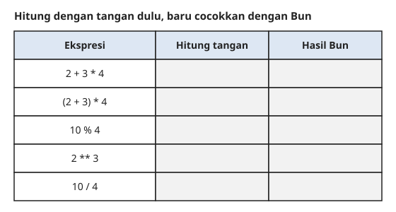

**Ingat dulu:** Tanpa melihat catatan, jawab. (1) Tulis perintah terminal yang menjalankan berkas `halo.js` dengan Bun. (2) Mengapa menukar dua nilai membutuhkan satu nilai sementara? (3) Mengapa data pribadi, kata sandi, dan kunci tidak boleh ditempel ke layanan AI?

1. ______
2. ______
3. ______



`[Gambar: tabel tiga kolom: ekspresi, hitung tangan, dan hasil Bun. Lima ekspresi sudah tertulis: 2 + 3 * 4, (2 + 3) * 4, 10 % 4, 2 ** 3, dan 10 / 4. Dua kolom hasil kosong. Dipakai pada Latihan 2.]`

**Prediksi:** `typeof` memberi tahu tipe sebuah nilai dan `%` adalah sisa bagi. Baca skrip ini, tebak dulu, tulis jawabanmu per baris, baru jalankan.

```js
// prediksi-tipe.js
let panjang = 7;
let lebar = 2;
console.log(panjang / lebar);
console.log(panjang % lebar);
console.log("7" + 2);
console.log("7" * 2);
console.log(typeof panjang);
console.log(typeof "7");
console.log(0.1 + 0.2);
```

Tujuh baris yang tercetak: ______

Apa beda `7` dan `"7"` bagi komputer? ______

**Lengkapi:** Fahrenheit sama dengan Celsius dikali 9, dibagi 5, ditambah 32. Isi bagian kosong; skrip dijalankan dengan `bun run suhu-setengah.js 100`.

```js setengah-jadi
// suhu-setengah.js
const celsius = Number(Bun.argv[2]);
const fahrenheit = ______ * 9 / 5 + ______;
console.log(celsius, "derajat Celsius =", ______, "derajat Fahrenheit");
```

**Susun:** Susun baris (sudah diacak) menjadi skrip yang membaca panjang satu sisi persegi dari argumen, lalu mencetak luas dan kelilingnya. Luas dicetak lebih dulu.

```text
(a) console.log("Keliling:", 4 * sisi);
(b) const sisi = Number(Bun.argv[2]);
(c) console.log("Luas:", sisi * sisi);
```

Urutan: ______

**Latihan:**

1. `AI: tanpa AI` Tanpa menjalankan, tulis apa yang tercetak.

   ```js
   let x = 5;
   x = x + 2;
   x = x * 3;
   console.log(x);
   console.log("x" + 1);
   console.log(x + "1");
   ```

   Tercetak: ______
2. `AI: tanpa AI` Hitung dengan tangan pada tabel di gambar, lalu cocokkan dengan Bun.
3. `AI: boleh` Tulis pseudocode lalu skrip yang membaca panjang dan lebar dari argumen dan mencetak luas dan keliling persegi panjang. ______
4. `AI: boleh` Tulis skrip yang menanyakan suhu Celsius dengan `prompt()` lalu mencetak suhu Fahrenheit. Uji dengan 0, 37, dan 100. ______

**Cek diri:**

- [ ] Saya dapat menjelaskan beda `let` dan `const`.
- [ ] Saya dapat menghitung ekspresi dengan urutan operasi yang benar.
- [ ] Saya dapat membaca masukan dari `Bun.argv` dan `prompt()` dan mengubahnya menjadi angka.

**Catatan cetak (untuk guru, tidak dicetak):** dua halaman A4. Kunci ada di modul `b-x1-m9`, bagian "Kunci dan petunjuk". Lembar tidak memuat kolom nama, kelas, tanggal, atau nilai.
