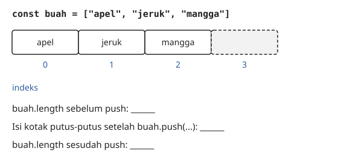

**Ingat dulu:** Tanpa melihat catatan, jawab. (1) Tulis fungsi panah `duaKali` yang mengembalikan dua kali parameternya. (2) Apa itu algoritma? Tulis pseudocode untuk menukar dua nilai. (3) Berapa kali blok `for (let i = 0; i < 5; i++)` berjalan, dan berapa nilai `i` pada putaran terakhir?

1. ______
2. ______
3. ______



`[Gambar: array buah berisi apel, jeruk, mangga pada indeks 0, 1, dan 2, dengan satu kotak putus-putus kosong di indeks 3. Di bawahnya tiga isian kosong: panjang sebelum push, isi kotak setelah push, dan panjang sesudah push. Dipakai pada Prediksi.]`

**Prediksi:** Array adalah daftar nilai berurutan; indeks pertama adalah 0 dan `length` adalah banyaknya elemen. Baca skrip ini, tebak dulu, tulis jawabanmu per baris, baru jalankan. Gunakan gambar untuk membantu.

```js
// prediksi-array.js
const buah = ["apel", "jeruk", "mangga"];
console.log(buah[0]);
console.log(buah[2]);
console.log(buah.length);
console.log(buah[3]);
buah.push("pisang");
console.log(buah.length);
console.log(buah[buah.length - 1]);
const angka = [1, 2, 3, 4];
console.log(angka.map((x) => x * 10));
```

Tujuh baris yang tercetak: ______

`buah` dideklarasikan dengan `const`, tetapi `push` berhasil. Apa yang kamu simpulkan tentang `const` pada array? ______

**Lengkapi:** Isi bagian kosong agar `genap` berisi `[2, 4]` dan `jumlahKuadrat` bernilai 30 (yaitu 1 + 4 + 9 + 16).

```js setengah-jadi
// array-setengah.js
const angka = [1, 2, 3, 4];
const genap = angka.filter((x) => x ______ 2 === 0);
console.log(genap);
const jumlahKuadrat = angka.map((x) => ______).reduce((a, b) => ______, 0);
console.log(jumlahKuadrat);
```

**Susun:** Susun baris (sudah diacak) menjadi fungsi `rataRata(daftar)` yang mengembalikan rata-rata elemen array.

```text
(a)   return jumlah / daftar.length;
(b)   for (const n of daftar) {
(c) function rataRata(daftar) {
(d)     jumlah += n;
(e)   let jumlah = 0;
(f) }
(g)   }
```

Urutan: ______

**Latihan:**

1. `AI: tanpa AI` Tanpa menjalankan, tulis apa yang tercetak.

   ```js
   const a = [5, 3, 8];
   const b = a;
   b.push(1);
   console.log(a.length);
   const c = a.map((x) => x * 2);
   console.log(c, a);
   console.log(a.filter((x) => x > 4).length);
   console.log(a[a.length - 1]);
   ```

   Tercetak: ______
2. `AI: boleh` Tulis pseudocode lalu fungsi `rataRata(daftar)`. Uji dengan `[80, 65, 90]` dan dengan array kosong, lalu jelaskan hasil yang kedua. ______
3. `AI: boleh` Dari `[80, 65, 90, 70, 55, 72]` (nilai karangan), cetak nilai yang lebih dari atau sama dengan 70 dan banyaknya, memakai `filter`. ______
4. `AI: boleh` Tulis fungsi `terbesar(daftar)` dengan `for...of` tanpa `Math.max`, lalu tulis versi `reduce`-nya. Uji dengan `[4, 9, 2]` dan `[-5, -2, -9]`. ______

**Cek diri:**

- [ ] Saya dapat membuat array dan membaca elemennya lewat indeks, termasuk elemen terakhir.
- [ ] Saya dapat menulis `map`, `filter`, dan `reduce` dan menjelaskan bedanya.
- [ ] Saya menguji fungsi array dengan array kosong.

**Catatan cetak (untuk guru, tidak dicetak):** dua halaman A4. Kunci ada di modul `b-x2-m1`, bagian "Kunci dan petunjuk". Lembar tidak memuat kolom nama, kelas, tanggal, atau nilai.
