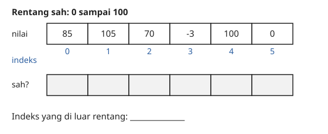

**Ingat dulu:** Tanpa melihat catatan, jawab. (1) Setelah satu putaran penuh bubble sort menaik, elemen mana yang pasti sudah di tempat akhirnya? (2) Mengapa `keluar()` pada wadah kosong berbahaya walaupun tidak menimbulkan galat, dan bagaimana mencegahnya? (3) Mengapa teks dari pengguna sebaiknya dirapikan dengan `trim()` dan `toLowerCase()` sebelum dibandingkan?

1. ______
2. ______
3. ______



`[Gambar: larik enam nilai 85, 105, 70, -3, 100, 0 dengan indeks 0 sampai 5. Di bawah tiap nilai ada kotak kosong untuk menulis sah atau tidak, dan satu garis kosong untuk indeks yang di luar rentang. Rentang sah 0 sampai 100. Dipakai pada Latihan 1.]`

**Prediksi:** `AI: tanpa AI`. Tebak dulu, tulis jawabanmu per baris, baru jalankan.

```js
// prediksi-data.js
console.log(Number("90"), Number(""), Number(null), Number("9o"));
console.log("90" > "100", 90 > 100);
console.log(Number.isNaN(Number("9o")), Number.isNaN("9o"));
const id = [1, 2, 2, 3, 2];
console.log(new Set(id).size, [...new Set(id)]);
```

Empat baris yang tercetak: ______

`Number("")` dan `Number(null)` mengejutkan atau tidak? Mengapa itu berbahaya untuk data nilai? ______

**Lengkapi:** Fungsi yang mengembalikan id yang muncul lebih dari sekali. `Set` punya `has` dan `add`. Isi bagian kosong.

```js setengah-jadi
// id-ganda-setengah.js
function idGanda(daftar) {
  const dilihat = new Set();
  const ganda = new Set();
  for (const b of daftar) {
    if (dilihat.______(b.id)) {
      ganda.______(b.id);
    }
    dilihat.______(b.id);
  }
  return [...______];
}
console.log(idGanda([{ id: 1 }, { id: 2 }, { id: 1 }, { id: 3 }, { id: 2 }, { id: 1 }]));
```

**Susun:** `AI: tanpa AI`. Susun baris (sudah diacak) menjadi fungsi `nilaiSah` yang benar hanya untuk angka sungguhan antara 0 dan 100.

```text
(a)   return n >= 0 && n <= 100;
(b) function nilaiSah(n) {
(c)   if (typeof n !== "number" || Number.isNaN(n)) {
(d)     return false;
(e)   }
(f) }
```

Urutan: ______

**Latihan:**

1. `AI: tanpa AI` Untuk data pada gambar dengan rentang sah 0 sampai 100, tulis indeks yang di luar rentang. Mengapa 100 dan 0 sah? ______
2. `AI: boleh` Tulis `diLuarRentang(daftar, min, maks)` yang mengembalikan array indeks yang tidak sah. Uji dengan data nomor 1 dan array kosong. ______
3. `AI: boleh` Dari array objek berid, kembalikan id ganda tanpa menghitung dua kali. Uji dengan `[1, 2, 1, 3, 2, 1]` sebagai id. ______
4. `AI: boleh` Tambahkan ke `kualitas.js` aturan baru: kelas hanya boleh `X-1` atau `X-2`, dan nilai hasil `Number("")` tidak boleh lolos. Tambahkan dua baris bermasalah baru sendiri. ______

**Cek diri:**

- [ ] Saya dapat menyebut empat pertanyaan kualitas data.
- [ ] Saya dapat menjelaskan apa yang diperbaiki komputer dan apa yang diserahkan ke manusia.
- [ ] Saya hanya memakai data karangan di latihan.

**Catatan cetak (untuk guru, tidak dicetak):** dua halaman A4. Kunci ada di modul `b-x2-m10`, bagian "Kunci dan petunjuk". Lembar tidak memuat kolom nama, kelas, tanggal, atau nilai.
