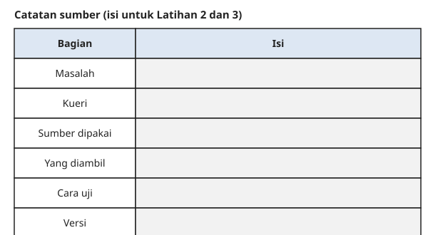

**Ingat dulu:** Tanpa melihat catatan, jawab. (1) Sebutkan tiga pemeriksaan kualitas data tabel dan satu masalah yang ditangkap masing-masing. (2) Mengapa batas digeser ke `tengah + 1` atau `tengah - 1`, bukan ke `tengah`? (3) Apa jadinya `JSON.parse('{nama: "Dewi"}')`, dan mengapa?

1. ______
2. ______
3. ______



`[Gambar: tabel dua kolom, Bagian dan Isi. Enam bagian sudah tertulis: Masalah, Kueri, Sumber dipakai, Yang diambil, Cara uji, dan Versi. Kolom Isi kosong. Dipakai pada Latihan 2 dan 3.]`

**Prediksi:** `AI: tanpa AI`. Dua metode ini mungkin belum kamu kenal; tebak dari namanya. Tebak dulu, tulis jawabanmu, baru jalankan.

```js
// prediksi-dokumentasi.js
const daftar = [10, 9, 1];
console.log(daftar.at(-1), daftar[-1]);
console.log("5".padStart(2, "0"), "12".padStart(2, "0"), "123".padStart(2, "0"));
```

Dua baris yang tercetak: ______

Bagaimana cara memastikan tebakanmu benar selain menjalankannya? ______

**Lengkapi:** Cetak tanggal `07/03/2026` dari angka `7`, `3`, `2026`. Hari dan bulan harus dua digit. Isi bagian kosong.

```js setengah-jadi
// format-tanggal-setengah.js
function formatTanggal(hari, bulan, tahun) {
  const h = ______(hari).padStart(______, "______");
  const b = String(bulan).padStart(2, "0");
  return h + "/" + b + "/" + ______;
}
console.log(formatTanggal(7, 3, 2026));
```

**Susun:** `AI: tanpa AI`. Susun baris (sudah diacak) menjadi fungsi `formatJam`, yang mengembalikan jam dan menit dua digit dipisah titik dua.

```text
(a)   const m = String(menit).padStart(2, "0");
(b)   return j + ":" + m;
(c) function formatJam(jam, menit) {
(d)   const j = String(jam).padStart(2, "0");
(e) }
```

Urutan: ______

**Latihan:**

1. `AI: tanpa AI` Tiga cuplikan karangan hasil pencarian dinilai dengan kriteria penulis, tanggal atau versi, contoh yang bisa dijalankan, dan konsistensi dengan sumber lain. Sumber C ditulis pengguna anonim, bertahun lama, punya contoh tanpa keluaran, dan bertentangan dengan dokumentasi resmi. Mengapa C tidak boleh dijadikan satu-satunya dasar? Tuliskan satu pemeriksaan yang bisa mengubah penilaianmu. ______
2. `AI: boleh` Urutkan `[3, 1, 2]` menjadi array baru tanpa mengubah aslinya, memakai metode yang kamu temukan di dokumentasi MDN tentang array (kata kunci: `array sort without mutating`). Isi catatan sumber pada gambar. ______
3. `AI: boleh` Tulis skrip yang mencetak semua argumen baris perintah setelah nama skrip, dibaca dari dokumentasi di `bun.sh` (kata kunci: `bun command line arguments`). Isi catatan sumber. ______
4. `AI: tanpa AI` Sebuah jawaban forum karangan memakai `teks.substr(1, 3)`. Bagaimana kamu memeriksa apakah itu masih dianjurkan, dan apa penggantinya? ______

**Cek diri:**

- [ ] Saya dapat merumuskan masalah menjadi kueri yang menyebut bahasa dan istilah.
- [ ] Saya menjalankan dan menguji hasilnya, termasuk kasus tepi.
- [ ] Saya menulis catatan sumber.

**Catatan cetak (untuk guru, tidak dicetak):** dua halaman A4. Kunci ada di modul `b-x2-m11`, bagian "Kunci dan petunjuk". Lembar tidak memuat kolom nama, kelas, tanggal, atau nilai.
