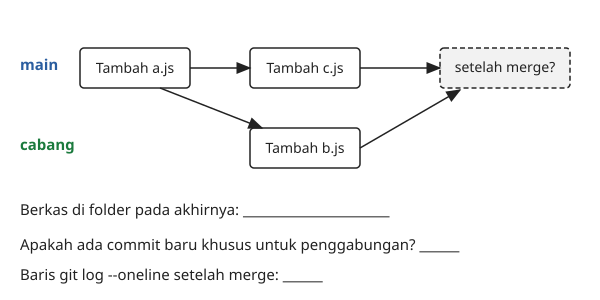

**Ingat dulu:** Tanpa melihat catatan, jawab. (1) Tulis kueri pencarian yang baik untuk menemukan cara menambah nol di depan angka di JavaScript, dan jelaskan mengapa menyebut bahasa dan nama hal yang dicari membantu. (2) Pada data seperti apa insertion sort sangat sedikit langkahnya, dan pada data seperti apa paling banyak? (3) Apa isi `<head>` dibandingkan dengan isi `<body>`?

1. ______
2. ______
3. ______



`[Gambar: dua jalur commit. Jalur main berisi Tambah a.js, Tambah c.js, lalu kotak putus-putus kosong berlabel "setelah merge?". Jalur cabang berisi Tambah b.js yang bercabang dari Tambah a.js dan menunjuk ke kotak kosong yang sama. Di bawahnya tiga isian kosong: berkas di folder pada akhirnya, apakah ada commit gabungan, dan baris git log setelah merge. Dipakai pada Prediksi.]`

**Prediksi:** `AI: tanpa AI`. Tebak dulu, tulis jawabanmu pada gambar, baru jalankan. Urutan perintah ini dijalankan di folder kosong. `git switch -c cabang` membuat cabang baru dan langsung berpindah ke sana; `--no-edit` memakai pesan gabungan bawaan.

```sh
git init -b main
echo 'console.log("a");' > a.js
git add a.js
git commit -m "Tambah a.js"
git switch -c cabang
echo 'console.log("b");' > b.js
git add b.js
git commit -m "Tambah b.js"
git switch main
echo 'console.log("c");' > c.js
git add c.js
git commit -m "Tambah c.js"
git merge --no-edit cabang
git log --oneline --graph
ls
```

**Lengkapi:** Budi membuat cabang `fitur-judul`, mencatat perubahan berkas yang sudah dilacak, dan mengirimnya ke pusat dengan menetapkan cabang pelacaknya. Isi bagian kosong.

```text
git ______ -c fitur-judul
git commit -a ______ "Tambah judul"
git ______ -u origin fitur-judul
```

**Susun:** `AI: tanpa AI`. Susun langkah (sudah diacak) untuk Dewi yang menerima pekerjaan Budi dan terjadi konflik. Tulis urutan hurufnya.

```text
(a) git commit -m "Gabung perubahan Budi"
(b) git merge origin/fitur-nama
(c) git fetch
(d) sunting salam.js: buang tanda <<<<<<<, =======, dan >>>>>>>
(e) git add salam.js
(f) git push
```

Urutan: ______

**Latihan:**

1. `AI: tanpa AI` Pada rangkaian di Prediksi, tulis apa yang berbeda bila `main` tidak mendapat commit `c.js` sebelum `git merge cabang`. ______
2. `AI: boleh` Berdua, buat `pusat.git`, dua folder klon, dan satu skrip kecil. Tiap orang membuat cabang, satu commit, dan mengirim cabangnya; lalu gabungkan keduanya ke `main` tanpa konflik (ubah baris yang berbeda). ______
3. `AI: boleh` Ulangi nomor 2 dengan mengubah baris yang sama, selesaikan konfliknya, dan tulis tiga langkah penyelesaiannya dengan kata-katamu. ______
4. `AI: tanpa AI` Ganti pesan `update`, `asdf`, dan `perbaikan` dengan pesan yang menjelaskan isi perubahan pada skrip `salam.js`. ______

**Cek diri:**

- [ ] Saya dapat menjelaskan `clone`, `fetch`, `pull`, dan `push`.
- [ ] Saya dapat membaca tanda konflik dan menyelesaikannya dengan `add` dan `commit`.
- [ ] Saya menulis pesan commit yang menjelaskan isi.

**Catatan cetak (untuk guru, tidak dicetak):** dua halaman A4. Kunci ada di modul `b-x2-m12`, bagian "Kunci dan petunjuk". Lembar tidak memuat kolom nama, kelas, tanggal, atau nilai.
