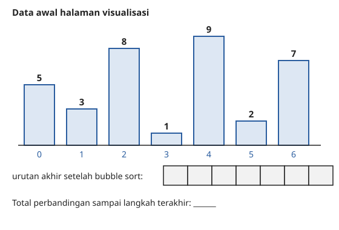

**Ingat dulu:** Tanpa melihat catatan, jawab. (1) Tulis perintah yang membuat cabang `fitur-x` dan langsung berpindah ke sana, dan jelaskan mengapa kerja di cabang berguna. (2) Apa hasil `Number("")` dan `Number("9o")`, dan bagaimana memeriksa bahwa hasilnya angka yang sah? (3) Tulis `@media` yang membuat `.dua-kolom` berjajar mulai lebar 600 piksel.

1. ______
2. ______
3. ______

`[Gambar: tujuh batang dengan tinggi sebanding nilai 5, 3, 8, 1, 9, 2, 7 dan nilai tertulis di tiap batang, indeks 0 sampai 6 di bawahnya. Di bawahnya tujuh kotak kosong untuk urutan akhir setelah bubble sort selesai, dan satu isian kosong untuk total perbandingan. Dipakai pada Prediksi.]`

**Prediksi:** Halaman visualisasi menampilkan bubble sort satu perbandingan demi satu pada data di gambar; tiap klik memajukan tepat satu perbandingan, dan dua batang yang dibandingkan ditandai bingkai dan kalimat status, bukan warna saja. Sebelum menulis kode, rencanakan: berapa total perbandingan, dan bagaimana urutan akhirnya? Tulis prediksimu pada gambar. Pisahkan juga dua berkas: `langkah.js` hanya ______ (menghitung atau menggambar?) dan `visual.js` hanya ______.

Rencana satu halaman punya enam bagian. Sebut keenamnya dari ingatan: ______

**Latihan:**

1. `AI: boleh` Tulis `langkahInsertion(awal)` yang mengembalikan keadaan array setelah tiap penyisipan dan ujilah dengan `[7, 3, 5, 2]`. ______
2. `AI: boleh` Tambahkan tombol `Mundur` ke halamanmu. ______
3. `AI: boleh` Tulis `langkahBiner(terurut, x)` yang mengembalikan `kiri`, `kanan`, `tengah`, dan nilai di tengah tiap langkah, dan uji dengan 23 pada `[2, 5, 8, 12, 16, 23, 38, 56, 72, 91]`. ______

**Cek diri:**

- [ ] Saya menulis rencana satu halaman sebelum kode.
- [ ] Saya menguji fungsi langkah di Bun dan halamannya di peramban.
- [ ] Saya hanya memakai data karangan.

**Catatan cetak (untuk guru, tidak dicetak):** dua halaman A4. Kunci ada di modul `b-x2-m13`, bagian "Kunci dan petunjuk". Modul ini berupa proyek, jadi lembar tidak memuat bagian Lengkapi dan Susun. Lembar tidak memuat kolom nama, kelas, tanggal, atau nilai.
