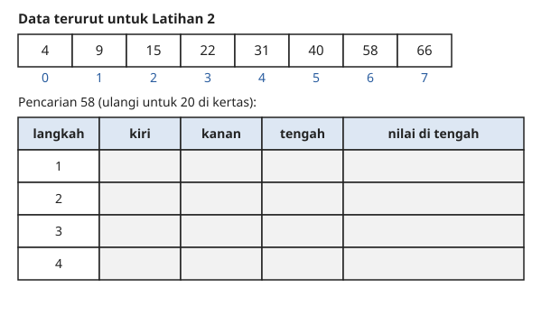

**Ingat dulu:** Jawab dari ingatan, tanpa melihat catatan. (1) Mengapa fungsi penghasil langkah dipisah dari kode penggambaran? (2) Mengapa teks dari pengguna dipasang dengan `textContent`, bukan `innerHTML`? (3) Apa syarat data agar pencarian biner boleh dipakai, dan mengapa syarat itu perlu?

1. ______
2. ______
3. ______



`[Gambar: larik terurut 4, 9, 15, 22, 31, 40, 58, 66 dengan indeks 0 sampai 7. Di bawahnya tabel lima kolom: langkah, kiri, kanan, tengah, dan nilai di tengah, dengan empat baris kosong. Dipakai pada Latihan 2.]`

**Latihan:** Kerjakan sendiri, `AI: tanpa AI`, dalam waktu yang ditetapkan gurumu.

1. `AI: tanpa AI` **Tulis.** Tulis `urutBubble(awal)` yang mengurutkan **salinan** array dengan bubble sort dan mengembalikan objek berisi array terurut dan banyak pertukaran, tanpa mengubah array asli. Ujilah dengan `[4, 1, 3, 2]` dan cetak juga array aslinya. ______
2. `AI: tanpa AI` **Telusuri.** Pada data di gambar, telusuri pencarian biner untuk `58` lalu untuk `20`. Tulis `kiri`, `kanan`, `tengah`, dan nilai di tengah pada tiap langkah, lalu hasilnya. Isi tabel di gambar untuk `58`.
3. `AI: tanpa AI` **Data.** Tulis `bersihkan(daftar)` untuk data di bawah. Aturan: buang spasi di tepi `nama`; ubah `nilai` menjadi angka; tolak baris dengan `nama` kosong, `nilai` bukan angka, atau `nilai` di luar 0 sampai 100; bila `id` muncul lagi, abaikan kemunculan berikutnya. Kembalikan baris bersih dan daftar `id` yang ditolak. Apa hasilnya untuk data ini?

   ```js
   const mentah = [
     { id: 1, nama: " Ani-contoh ", nilai: "80" },
     { id: 2, nama: "Beni-contoh", nilai: 120 },
     { id: 3, nama: "", nilai: 75 },
     { id: 1, nama: "Ani-contoh", nilai: 80 },
     { id: 5, nama: "Cici-contoh", nilai: "tujuh" },
     { id: 6, nama: "Dedi-contoh", nilai: 65 },
   ];
   ```

   ______
4. `AI: tanpa AI` **Dokumentasi.** Teks `"7"` harus menjadi `"07"`. Tulis satu kueri pencarian yang kamu pakai, sumber yang kamu pilih dan dua alasannya, satu pemeriksaan sebelum memercayainya, dan kodenya. ______

**Cek diri:**

- [ ] Saya dapat menulis dan menelusuri pencarian biner dan menyebut syaratnya.
- [ ] Saya dapat memvalidasi data tabel dan menemukan duplikat dengan `Set`.
- [ ] Saya dapat menilai sumber dan membaca dokumentasi resmi.

**Catatan cetak (untuk guru, tidak dicetak):** dua halaman A4. Kunci ada di modul `b-x2-m14`, bagian "Kunci dan petunjuk". Modul ini asesmen, jadi lembar tidak memuat bagian Prediksi, Lengkapi, dan Susun. Lembar tidak memuat kolom nama, kelas, tanggal, atau nilai.
