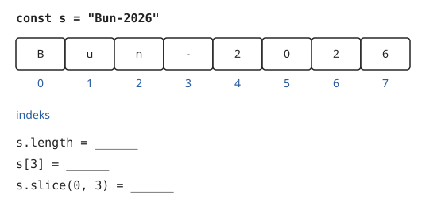

**Ingat dulu:** Tanpa melihat catatan, jawab. (1) Apa indeks elemen pertama sebuah array, dan ekspresi apa yang memberi elemen terakhir dari `daftar`? (2) `prompt()` selalu mengembalikan teks. Apa yang harus dilakukan sebelum teks itu dibandingkan dengan angka? (3) Apa hasil `typeof "5"`, dan apa yang tercetak oleh `console.log("5" + 3)`?

1. ______
2. ______
3. ______



`[Gambar: string Bun-2026 digambar sebagai delapan kotak, satu huruf per kotak, dengan indeks 0 sampai 7 di bawahnya. Di bawahnya tiga isian kosong: s.length, s[3], dan s.slice(0, 3). Dipakai pada Latihan 1.]`

**Prediksi:** String adalah teks; hurufnya punya indeks mulai dari 0. Templat memakai backtick dan boleh memuat `${...}`. Baca skrip ini, tebak dulu, tulis jawabanmu per baris, baru jalankan.

```js
// prediksi-string.js
const nama = "Dewi-contoh";
console.log(nama.length);
console.log(nama[0]);
console.log(nama[nama.length - 1]);
console.log(nama.toUpperCase());
console.log(nama);
const umur = 16;
console.log(`${nama} berumur ${umur + 1} tahun depan`);
console.log("a,b,c".split(","));
```

Tujuh baris yang tercetak: ______

Setelah `nama.toUpperCase()`, apakah `nama` berubah? Apa buktinya dari keluaran? ______

**Lengkapi:** Isi nama metode agar keluarannya `[belajar JavaScript]`, `true`, `2`, dan `belajar-JavaScript`.

```js setengah-jadi
// teks-setengah.js
const kalimat = "  belajar JavaScript  ";
const rapi = kalimat.______();
console.log(`[${rapi}]`);
console.log(rapi.______("JavaScript"));
const kata = rapi.______(" ");
console.log(kata.length);
console.log(kata.______("-"));
```

**Susun:** Susun baris (sudah diacak) menjadi fungsi `hitungVokal(teks)` yang mengembalikan banyaknya huruf vokal.

```text
(a)   return banyak;
(b)       banyak++;
(c)   let banyak = 0;
(d) function hitungVokal(teks) {
(e)     if ("aiueo".includes(huruf)) {
(f)   for (const huruf of teks.toLowerCase()) {
(g)     }
(h)   }
(i) }
```

Urutan: ______

**Latihan:**

1. `AI: tanpa AI` Tanpa menjalankan, tulis apa yang tercetak. Gambar membantumu membaca `s`.

   ```js
   const s = "Bun-2026";
   console.log(s.length, s[3], s.slice(0, 3));
   console.log(s.toLowerCase() === "bun-2026");
   console.log("5" + 3, "5" - 3);
   console.log(s.split("-"));
   ```

   Tercetak: ______
2. `AI: boleh` Tulis pseudocode lalu fungsi `apakahPalindrom(teks)`. Uji dengan `"katak"`, `"Kasur ini rusak"`, dan `"informatika"`. ______
3. `AI: boleh` Hitung vokal pada `"Informatika Itu Seru"` dengan fungsi `hitungVokal`. Telusuri dulu dua kata pertama dengan tabel, lalu cocokkan dengan Bun. ______
4. `AI: boleh` Tulis fungsi `hitungKata(kalimat)` yang benar walaupun kalimatnya diawali spasi atau memuat spasi ganda, misalnya `"  belajar  web  hari ini "`. ______

**Cek diri:**

- [ ] Saya tahu metode string mengembalikan string baru dan tidak mengubah yang lama.
- [ ] Saya dapat menelusuri algoritma dua penunjuk dengan tabel.
- [ ] Saya menulis pseudocode sebelum fungsinya.

**Catatan cetak (untuk guru, tidak dicetak):** dua halaman A4. Kunci ada di modul `b-x2-m2`, bagian "Kunci dan petunjuk". Lembar tidak memuat kolom nama, kelas, tanggal, atau nilai.
