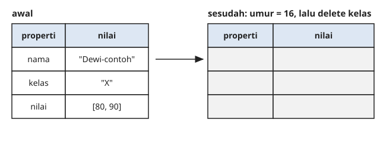

**Ingat dulu:** Tanpa melihat catatan, jawab. (1) Tulis templat string yang mencetak `Halo, <nama>!` memakai variabel `nama`. (2) Apa yang dikembalikan `push`, dan apa yang dikembalikan `pop`? (3) Sebutkan tiga nilai yang termasuk falsy.

1. ______
2. ______
3. ______



`[Gambar: dua tabel properti dan nilai. Tabel awal berisi nama "Dewi-contoh", kelas "X", nilai [80, 90]. Panah menuju tabel sesudah yang tiga barisnya kosong; judulnya: umur = 16, lalu delete kelas. Isi tabel sesudah. Dipakai pada Prediksi.]`

**Prediksi:** Objek mengelompokkan nilai dengan nama; pasangan `nama: nilai` disebut properti. Baca skrip ini, tebak dulu, tulis jawabanmu per baris, baru jalankan. Tabel pada gambar membantumu mencatat isi objek.

```js
// prediksi-objek.js
const murid = { nama: "Dewi-contoh", kelas: "X", nilai: [80, 90] };
console.log(murid.nama);
console.log(murid["kelas"]);
console.log(murid.nilai[1]);
console.log(murid.umur);
murid.umur = 16;
console.log(murid.umur);
delete murid.kelas;
console.log(murid);
console.log(JSON.stringify(murid));
```

Baris yang tercetak sebelum `console.log(murid)`: ______

`murid.umur` tidak ada di awal. Apa yang terjadi saat dibaca, dan setelah diberi nilai? ______

**Lengkapi:** Isi bagian kosong agar keluarannya `75`, `Budi-contoh`, teks JSON dengan properti `kelas`, dan `X`.

```js setengah-jadi
// objek-setengah.js
const siswa = { nama: "Budi-contoh", nilai: 75 };
console.log(siswa.______);
console.log(siswa["______"]);
siswa.______ = "X";
const teks = JSON.______(siswa);
console.log(teks);
const objek = JSON.______(teks);
console.log(objek.kelas);
```

**Susun:** Susun baris (sudah diacak) menjadi fungsi `cariBuku(daftar, judul)` yang mengembalikan objek buku pertama dengan judul itu, atau `null` bila tidak ada.

```text
(a)   return b;
(b) function cariBuku(daftar, judul) {
(c)   return null;
(d)     if (b.judul === judul) {
(e) }
(f)   for (const b of daftar) {
(g)     }
(h)   }
```

Urutan: ______

**Latihan:**

1. `AI: tanpa AI` Tanpa menjalankan, tulis apa yang tercetak.

   ```js
   const a = { x: 1, y: { z: 2 } };
   const b = a;
   b.y.z = 9;
   console.log(a.y.z);
   console.log(a.w);
   console.log(a.w === undefined);
   console.log(JSON.stringify({ n: 1, f: undefined, s: "t" }));
   console.log(JSON.parse("[1, 2, 3]").length);
   ```

   Lima baris tercetak: ______
2. `AI: boleh` Buat array tiga objek buku karanganmu sendiri, tambahkan satu buku, cetak judul yang tersedia, lalu simpan ke `buku.json` dan baca kembali. ______
3. `AI: boleh` Tulis pseudocode lalu fungsi `cariBuku(daftar, judul)`. Uji dengan judul yang ada dan yang tidak ada. ______
4. `AI: boleh` Dari daftar tiga buku, buat objek `rekap` dengan properti `tersedia` dan `dipinjam` yang berisi banyaknya buku masing-masing, lalu hitung rata-rata tahun terbitnya dengan `reduce`. ______

**Cek diri:**

- [ ] Saya dapat menambah, mengubah, dan menghapus properti.
- [ ] Saya dapat mengubah objek menjadi JSON dan sebaliknya.
- [ ] Saya tahu aturan JSON: nama properti bertanda kutip ganda dan tanpa koma di ujung.

**Catatan cetak (untuk guru, tidak dicetak):** dua halaman A4. Kunci ada di modul `b-x2-m3`, bagian "Kunci dan petunjuk". Lembar tidak memuat kolom nama, kelas, tanggal, atau nilai.
