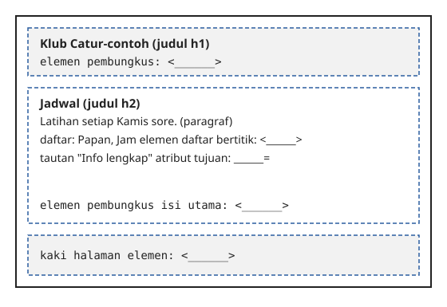

**Ingat dulu:** Tanpa melihat catatan, jawab. (1) Tulis objek `buku` dengan properti `judul` dan `tahun`, lalu cetak judulnya dengan titik dan dengan kurung siku. (2) Apa beda `map` dan `filter`? (3) Apa tugas DNS ketika kamu mengetik alamat sebuah situs di peramban?

1. ______
2. ______
3. ______



`[Gambar: sketsa halaman dengan tiga zona putus-putus. Zona atas bertuliskan Klub Catur-contoh sebagai judul h1; zona tengah memuat Jadwal sebagai judul h2, paragraf latihan setiap Kamis sore, daftar Papan dan Jam, dan tautan Info lengkap; zona bawah adalah kaki halaman. Tiap zona punya isian kosong untuk nama elemen HTML, dan tautan punya isian kosong untuk nama atributnya. Dipakai pada Lengkapi.]`

**Prediksi:** HTML menandai isi dengan tag yang biasanya berpasangan, dan tag bersarang ditutup dari yang dibuka paling akhir. Baca berkas ini, tebak dulu, tulis jawabanmu, baru buka di peramban.

```html
<!doctype html>
<html lang="id">
  <head>
    <meta charset="utf-8">
    <title>Prediksi</title>
  </head>
  <body>
    <h1>Judul besar</h1>
    <p>Satu <strong>kalimat</strong> pendek.</p>
    <ul>
      <li>Satu</li>
      <li>Dua</li>
    </ul>
    <a href="https://example.com/">Ke contoh</a>
  </body>
</html>
```

Teks apa yang tampak di halaman, dan bagian mana yang tidak tampak? ______

Bagian mana yang tampil tebal, dan mana yang tampil sebagai butir? ______

Apa yang terjadi saat tautan diklik? ______

**Lengkapi:** Halaman klub karangan. Isi bahasa halaman (Indonesia), elemen kepala halaman, elemen isi utama, elemen daftar bertitik, dan atribut tujuan tautan. Gambar menunjukkan letaknya.

```html setengah-jadi
<!doctype html>
<html lang="______">
  <head>
    <meta charset="utf-8">
    <title>Klub Catur-contoh</title>
  </head>
  <body>
    <______>
      <h1>Klub Catur-contoh</h1>
    </______>
    <______>
      <h2>Jadwal</h2>
      <p>Latihan setiap Kamis sore.</p>
      <______>
        <li>Papan</li>
        <li>Jam</li>
      </______>
      <a ______="https://example.com/">Info lengkap</a>
    </______>
  </body>
</html>
```

**Susun:** Susun baris (sudah diacak) menjadi halaman HTML paling sederhana yang benar.

```text
(a)   <body>
(b) </html>
(c)     <title>Halaman Pertama</title>
(d) <html lang="id">
(e)   </head>
(f)   </body>
(g)   <head>
(h)     <h1>Halo</h1>
(i) <!doctype html>
```

Urutan: ______

**Latihan:**

1. `AI: tanpa AI` Tanpa membuka peramban, tulis apa yang akan tampil (berkas `x.svg` tidak ada).

   ```html
   <h1>Judul</h1>
   <p>Satu
      dua
      tiga</p>
   <ol>
     <li>A</li>
     <li>B</li>
   </ol>
   
   ```

   Tampil: ______
2. `AI: boleh` Gambar dulu sketsa susunan halaman di kertas (kepala, navigasi, dua bagian, kaki halaman), lalu tulis `profil.html` untuk tokoh karanganmu sendiri: `h1`, dua `section` dengan `h2`, satu daftar, satu tautan ke bagian lain di halaman yang sama, dan `footer`. Buka di peramban dan cocokkan dengan sketsamu.
3. `AI: boleh` Tulis ulang potongan ini dengan `header`, `h1`, `main`, dan `footer`:

   ```html
   <div class="atas"><div class="judul">Klub Catur-contoh</div></div>
   <div class="isi"><p>Latihan setiap Kamis sore.</p></div>
   <div class="bawah">Halaman karangan</div>
   ```

   ______
4. `AI: boleh` Pada `profil.html`, periksa: ada `<!doctype html>`, `lang`, dan `<title>`; satu `h1`; judul tidak melompat; tiap gambar punya `alt`.

**Cek diri:**

- [ ] Saya dapat menulis kerangka HTML lengkap dari ingatan.
- [ ] Saya dapat memilih elemen semantik sesuai artinya.
- [ ] Saya membuat sketsa halaman dan mencocokkannya dengan hasil di peramban.

**Catatan cetak (untuk guru, tidak dicetak):** dua halaman A4. Kunci ada di modul `b-x2-m4`, bagian "Kunci dan petunjuk". Lembar tidak memuat kolom nama, kelas, tanggal, atau nilai.
