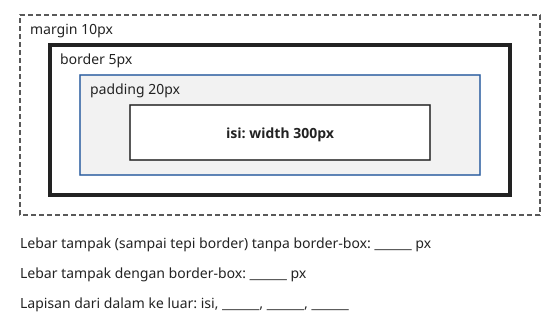

**Ingat dulu:** Tanpa melihat catatan, jawab. (1) Sebutkan tiga elemen semantik HTML selain `div` dan fungsi masing-masing. (2) Tulis kode yang mengubah `"a-b-c"` menjadi array `["a", "b", "c"]`. (3) Apa indeks elemen pertama sebuah array, dan ekspresi apa yang memberi elemen terakhir dari `daftar`?

1. ______
2. ______
3. ______



`[Gambar: empat persegi panjang bersarang berlabel margin 10px (putus-putus), border 5px, padding 20px, dan isi dengan width 300px. Di bawahnya tiga isian kosong: lebar tampak tanpa border-box, lebar tampak dengan border-box, dan nama tiga lapisan setelah isi. Dipakai pada Latihan 1.]`

**Prediksi:** CSS berisi aturan: selektor yang memilih elemen, lalu daftar `properti: nilai;`. Tebak dulu, tulis jawabanmu, baru buka di peramban.

```html
<p>Satu</p>
<p class="penting">Dua</p>
<p class="penting" id="khusus">Tiga</p>
```

```css
p { color: blue; }
.penting { color: green; }
#khusus { color: red; }
p { font-size: 20px; }
```

Warna dan ukuran huruf `Satu`: ______  `Dua`: ______  `Tiga`: ______

Mengapa warna tidak ditentukan oleh urutan penulisan saja? ______

**Lengkapi:** Daftar kartu yang menumpuk di layar sempit dan berjajar mulai 600 piksel. Isi properti ukuran kotak, selektor daftar, awalan lebar minimum, arah baris, dan nilai `flex` pembagi rata.

```html
<ul class="daftar-kartu">
  <li class="kartu">Papan</li>
  <li class="kartu">Jam</li>
  <li class="kartu">Buku</li>
</ul>
```

```css setengah-jadi
* {
  ______: border-box;
}
______ {
  display: flex;
  flex-direction: column;
  gap: 12px;
  padding: 0;
  list-style: none;
}
.kartu {
  padding: 12px;
  border: 1px solid #555555;
}
@media (______-width: 600px) {
  .daftar-kartu {
    flex-direction: ______;
  }
  .kartu {
    flex: ______;
  }
}
```

**Susun:** Susun baris (sudah diacak) menjadi dua aturan: judul berukuran 24 piksel, dan pada lebar 600 piksel ke atas berukuran 32 piksel. Baris (g) dan (h) sama persis, jadi boleh bertukar tempat.

```text
(a)     font-size: 32px;
(b) .judul {
(c) @media (min-width: 600px) {
(d)   }
(e)   font-size: 24px;
(f)   .judul {
(g) }
(h) }
```

Urutan: ______

**Latihan:**

1. `AI: tanpa AI` Tanpa membuka peramban, jawab. (a) Paragraf `<p class="penting">` dengan aturan `.penting { color: red; }` lalu `p.penting { color: green; }` berwarna apa, dan mengapa? (b) Berapa lebar tampak kotak `width: 300px; padding: 20px; border: 5px solid black; margin: 10px;`, dengan dan tanpa `box-sizing: border-box`? Lebar tampak dihitung sampai tepi border. Gunakan gambar. ______
2. `AI: boleh` Sketsa dulu halaman profil dari `b-x2-m4` di kertas (warna dan jarak). Tulis dan tautkan `gaya.css`: warna latar `header`, jarak antar-bagian, gaya `nav`. Buka di peramban dan cocokkan dengan sketsamu. ______
3. `AI: boleh` Tambahkan `section` ketiga ("Biaya"). Perkirakan lebar tiap kolom pada jendela 700 piksel sebelum mengukurnya. ______
4. `AI: boleh` Buka halamanmu pada jendela sempit (sekitar 400 piksel) dan lebar (sekitar 800 piksel): tidak ada gulir mendatar, teks terbaca, susunan berubah pada 600 piksel. ______

**Cek diri:**

- [ ] Saya dapat menyebut empat lapisan model kotak dan memakai `border-box`.
- [ ] Saya dapat membuat susunan yang menumpuk di layar sempit dan berjajar di layar lebar.
- [ ] Saya memeriksa halamanku pada dua lebar jendela.

**Catatan cetak (untuk guru, tidak dicetak):** dua halaman A4. Kunci ada di modul `b-x2-m5`, bagian "Kunci dan petunjuk". Lembar tidak memuat kolom nama, kelas, tanggal, atau nilai.
