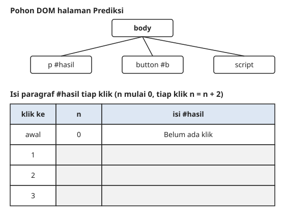

**Ingat dulu:** Tanpa melihat catatan, jawab. (1) Sebutkan empat lapisan model kotak dari dalam ke luar, dan apa yang diubah `box-sizing: border-box`. (2) Apa yang dikerjakan `JSON.stringify` dan `JSON.parse`? (3) Apa beda parameter dan argumen?

1. ______
2. ______
3. ______



`[Gambar: pohon DOM dengan simpul body di atas dan tiga anak: p #hasil, button #b, dan script. Di bawahnya tabel dengan kolom klik ke, n, dan isi #hasil. Baris awal berisi n = 0 dan "Belum ada klik"; baris klik ke 1, 2, 3 kosong. Dipakai pada Prediksi.]`

**Prediksi:** Baca halaman berikut, tebak dulu, tulis jawabanmu pada tabel di gambar, baru jalankan. Peramban menjalankan skrip setelah membaca elemen di atasnya.

```html
<p id="hasil">Belum ada klik</p>
<button id="b">Klik</button>
<script>
let n = 0;
document.querySelector("#b").addEventListener("click", () => {
  n = n + 2;
  document.querySelector("#hasil").textContent = "Nilai: " + n;
});
</script>
```

Mengapa isi paragraf tidak berubah saat halaman selesai dimuat? ______

**Lengkapi:** Halaman sapaan karangan. Isi metode pemilih elemen, metode pemasang pendengar, properti isi isian, dan properti teks elemen.

```html setengah-jadi
<input id="nama" type="text">
<button id="sapa" type="button">Sapa</button>
<p id="salam"></p>
<script>
const isian = document.querySelector("#nama");
const tombol = document.querySelector("#sapa");
const salam = document.______("#salam");
tombol.______("click", () => {
  const nama = isian.______.trim();
  salam.______ = `Halo, ${nama}!`;
});
</script>
```

**Susun:** Susun baris (sudah diacak) menjadi `hitung.js` yang bekerja. Baris (e), (f), dan (g) boleh bertukar tempat asal semuanya mendahului (b).

```text
(a)   jumlah = jumlah + 1;
(b) tombol.addEventListener("click", () => {
(c)   tampilan.textContent = jumlah;
(d) });
(e) const tombol = document.querySelector("#tambah");
(f) let jumlah = 0;
(g) const tampilan = document.querySelector("#jumlah");
```

Urutan: ______

**Latihan:**

1. `AI: tanpa AI` Tanpa menjalankan, tulis isi atribut `class` paragraf setelah tombol diklik 1, 2, dan 3 kali.

   ```html
   <p id="p" class="a">Teks</p>
   <button id="b">Ganti</button>
   <script>
   document.querySelector("#b").addEventListener("click", () => {
     document.querySelector("#p").classList.toggle("b");
   });
   </script>
   ```

   Klik 1: ______  Klik 2: ______  Klik 3: ______
2. `AI: boleh` Tambahkan tombol `Kurang` pada penghitung klik; nilai tidak boleh di bawah 0. Tulis dulu tiga langkah rencanamu (pilih elemen, pasang pendengar, ubah isi). ______
3. `AI: boleh` Pada daftar tugas, tampilkan banyak butir berkelas `selesai` di sebuah `p`. Perbarui setiap kali butir ditambah atau diklik. ______
4. `AI: boleh` Letakkan `<script src="hitung.js"></script>` di `head` tanpa `defer`, buka konsol peramban (biasanya tombol F12), dan catat pesan galat. Perbaiki dengan dua cara berbeda. ______

**Cek diri:**

- [ ] Saya dapat memasang pendengar `click` dan `submit`.
- [ ] Saya dapat menambah elemen dan mengganti kelas dengan `createElement` dan `classList.toggle`.
- [ ] Saya dapat menjelaskan galat `null` dan memperbaikinya.

**Catatan cetak (untuk guru, tidak dicetak):** dua halaman A4. Kunci ada di modul `b-x2-m6`, bagian "Kunci dan petunjuk". Lembar tidak memuat kolom nama, kelas, tanggal, atau nilai.
