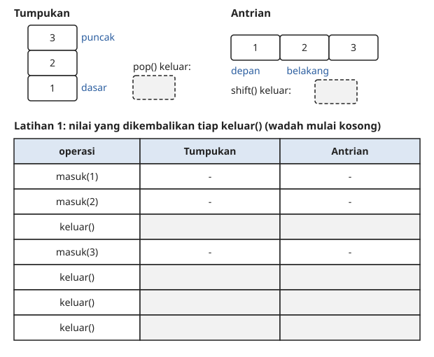

**Ingat dulu:** Tanpa melihat catatan, jawab. (1) Apa yang dilakukan `addEventListener("click", fungsi)`, dan kapan `fungsi` dijalankan? (2) Mengapa gambar memerlukan atribut `alt`? (3) Apa indeks elemen pertama sebuah array, dan ekspresi apa yang memberi elemen terakhir dari `daftar`?

1. ______
2. ______
3. ______



`[Gambar: di kiri tumpukan vertikal berisi 3 di puncak, 2, dan 1 di dasar; di kanan antrian horizontal 1, 2, 3 dengan depan di kiri dan belakang di kanan. Masing-masing punya kotak kosong untuk elemen yang keluar. Di bawahnya tabel tiga kolom: operasi, Tumpukan, Antrian, untuk tujuh operasi masuk(1), masuk(2), keluar(), masuk(3), keluar(), keluar(), keluar(). Sel hasil keluar() kosong. Dipakai pada Prediksi dan Latihan 1.]`

**Prediksi:** `AI: tanpa AI`. Tebak dulu, tulis jawabanmu, baru jalankan. Kotak keluaran pada gambar membantumu.

```js
const tumpukan = [];
const antrian = [];
for (let i = 1; i <= 3; i++) {
  tumpukan.push(i);
  antrian.push(i);
}
console.log(tumpukan.pop(), antrian.shift());
console.log(tumpukan.pop(), antrian.shift(), tumpukan.length);
```

Dua baris yang tercetak: ______

Keduanya diisi 1, 2, 3 dalam urutan yang sama. Mengapa elemen yang keluar berbeda? ______

**Lengkapi:** Membalik kata dengan kelas `Tumpukan` (metode `masuk`, `kosong`, `keluar`): huruf dimasukkan satu per satu, lalu diambil dari atas. Isi bagian kosong.

```js setengah-jadi
const t = new Tumpukan();
for (const huruf of "kode") {
  t.______(huruf);
}
let hasil = "";
while (!t.______()) {
  hasil = hasil + t.______();
}
console.log(hasil);
```

**Susun:** `AI: tanpa AI`. Susun baris (sudah diacak) menjadi program yang mencetak 5, lalu 8, dari sebuah `Antrian`. Baris (a) dan (e) sama persis, jadi boleh bertukar tempat.

```text
(a) console.log(a.depan());
(b) a.masuk(8);
(c) a.keluar();
(d) const a = new Antrian();
(e) console.log(a.depan());
(f) a.masuk(5);
```

Urutan: ______

**Latihan:**

1. `AI: tanpa AI` Pada `Tumpukan` kosong lalu pada `Antrian` kosong, jalankan `masuk(1)`, `masuk(2)`, `keluar()`, `masuk(3)`, `keluar()`, `keluar()`, `keluar()`. Isi tabel pada gambar dengan nilai yang dikembalikan tiap `keluar()`.
2. `AI: boleh` Tulis pseudocode lalu skrip yang menguji palindrom dengan satu `Tumpukan` dan satu `Antrian`: masukkan tiap huruf ke keduanya, lalu bandingkan huruf yang keluar dari keduanya. Uji dengan `katak` dan `kayu`. ______
3. `AI: boleh` Dalam notasi postfiks operatornya mengikuti dua angka: `5 2 + 3 *` bermakna (5 + 2) x 3. Tulis fungsi yang membaca teks itu (dipecah dengan `split(" ")`): angka dimasukkan ke tumpukan; operator `+`, `-`, `*` mengambil dua angka teratas dan memasukkan hasilnya. Uji dengan `5 2 + 3 *` dan `10 4 -`. ______
4. `AI: boleh` Tulis kelas `Riwayat` dengan `kunjungi(nama)` dan `kembali()`; `kembali()` membuang halaman sekarang dan mengembalikan halaman sebelumnya, tetapi tidak membuang halaman terakhir yang tersisa. Uji dengan `beranda`, `profil`, `galeri`, lalu tiga kali `kembali()`. ______

**Cek diri:**

- [ ] Saya dapat menjelaskan LIFO dan FIFO dengan contoh.
- [ ] Saya dapat menangani wadah kosong dengan `kosong()`.
- [ ] Saya menulis pseudocode sebelum skripnya.

**Catatan cetak (untuk guru, tidak dicetak):** dua halaman A4. Kunci ada di modul `b-x2-m7`, bagian "Kunci dan petunjuk". Lembar tidak memuat kolom nama, kelas, tanggal, atau nilai.
