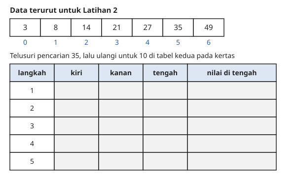

**Ingat dulu:** Tanpa melihat catatan, jawab. (1) Apa beda LIFO dan FIFO? Beri satu contoh sehari-hari untuk tiap-tiapnya. (2) Mengapa `#khusus` mengalahkan `.penting` dan `.penting` mengalahkan `p`, walaupun urutan penulisannya berbeda? (3) Berapa tebakan terbanyak yang cukup untuk menemukan angka 1 sampai 100 bila selalu menebak tengah-tengah rentang?

1. ______
2. ______
3. ______



`[Gambar: larik terurut 3, 8, 14, 21, 27, 35, 49 dengan indeks 0 sampai 6. Di bawahnya tabel lima kolom: langkah, kiri, kanan, tengah, dan nilai di tengah, dengan lima baris kosong. Dipakai pada Latihan 2.]`

**Prediksi:** `AI: tanpa AI`. Fungsi `cariIndeks` memeriksa elemen satu per satu dan mengembalikan indeks pertama yang berisi `x` (atau -1) serta banyak perbandingan. Tebak dulu, tulis jawabanmu, baru jalankan.

```js
// prediksi-cari.js
function cariIndeks(daftar, x) {
  let banding = 0;
  for (let i = 0; i < daftar.length; i++) {
    banding++;
    if (daftar[i] === x) {
      return { indeks: i, banding: banding };
    }
  }
  return { indeks: -1, banding: banding };
}
const data = [4, 9, 7, 1, 7];
const a = cariIndeks(data, 7);
console.log(a.indeks, a.banding);
const b = cariIndeks(data, 5);
console.log(b.indeks, b.banding);
console.log(data.indexOf(7), data.indexOf(5));
```

Tiga baris yang tercetak: ______

Angka 7 muncul dua kali. Mengapa fungsi hanya melaporkan satu indeks? ______

**Lengkapi:** Isi bagian kosong pada pencarian biner berikut. Fungsi ini hanya mengembalikan indeks.

```js setengah-jadi
// biner-setengah.js
function cariBiner(terurut, x) {
  let kiri = 0;
  let kanan = terurut.length - 1;
  while (kiri ______ kanan) {
    const tengah = Math.floor((kiri + kanan) / ______);
    if (terurut[tengah] === x) {
      return ______;
    } else if (terurut[tengah] < x) {
      kiri = ______;
    } else {
      kanan = ______;
    }
  }
  return -1;
}
```

**Susun:** `AI: tanpa AI`. Susun delapan baris (sudah diacak) menjadi badan satu putaran `while` pencarian biner.

```text
(a)     kiri = tengah + 1;
(b)   const tengah = Math.floor((kiri + kanan) / 2);
(c)     return tengah;
(d)   } else {
(e)     kanan = tengah - 1;
(f)   } else if (terurut[tengah] < x) {
(g)   if (terurut[tengah] === x) {
(h)   }
```

Urutan: ______

**Latihan:**

1. `AI: boleh` Tulis pseudocode lalu skrip: untuk tiap `x` dalam `[7, 5, 4]`, cetak indeks pertama kemunculannya di `[4, 9, 7, 1, 7]` atau -1, memakai pencarian sekuensial tulisanmu sendiri. ______
2. `AI: tanpa AI` Pada data di gambar, telusuri pencarian biner untuk `35` lalu untuk `10`. Tulis nilai `kiri`, `kanan`, `tengah`, dan nilai di tengah pada tiap langkah. Gunakan tabel di gambar untuk yang pertama dan kertas untuk yang kedua.
3. `AI: boleh` Angka rahasia 1 sampai 100 diberikan sebagai argumen (`bun run tebak-biner.js 73`, dibaca dengan `Number(Bun.argv[2])`). Tulis skrip yang menebak dengan membagi dua daerah tebakan dan mencetak tiap tebakan beserta penilaiannya (`terlalu kecil`, `terlalu besar`, atau `tepat`). Uji dengan 73. ______
4. `AI: boleh` Pada data terurut menaik, kembalikan indeks elemen pertama yang tidak lebih kecil dari `x`, atau `terurut.length` bila tidak ada. Uji dengan `[1, 3, 3, 3, 7, 9]` dan `x` sama dengan 3, 4, dan 10. ______

**Cek diri:**

- [ ] Saya dapat menyebut syarat pencarian biner dan alasannya.
- [ ] Saya dapat menelusuri pencarian biner dengan tabel `kiri`, `kanan`, `tengah`.
- [ ] Saya dapat menjelaskan mengapa langkah biner naik pelan saat data membesar.

**Catatan cetak (untuk guru, tidak dicetak):** dua halaman A4. Kunci ada di modul `b-x2-m8`, bagian "Kunci dan petunjuk". Lembar tidak memuat kolom nama, kelas, tanggal, atau nilai.
