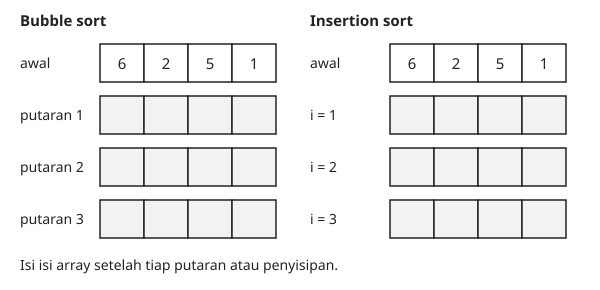

**Ingat dulu:** Tanpa melihat catatan, jawab. (1) Apa syarat data agar pencarian biner boleh dipakai, dan mengapa syarat itu perlu? (2) Mengapa `document.querySelector` dapat mengembalikan `null`, dan bagaimana mencegahnya? (3) Tulis kode yang menukar `daftar[0]` dengan `daftar[1]` memakai satu variabel sementara.

1. ______
2. ______
3. ______



`[Gambar: dua blok jejak array. Blok kiri berjudul Bubble sort, blok kanan Insertion sort. Tiap blok mulai dari baris awal berisi 6 2 5 1, lalu tiga baris berisi empat kotak kosong: putaran 1 sampai 3 untuk bubble sort dan i = 1 sampai 3 untuk insertion sort. Dipakai pada Latihan 1.]`

**Prediksi:** `AI: tanpa AI`. Skrip mencetak isi array setelah tiap putaran luar; `a.join(" ")` menyambung elemen dengan spasi. Tebak dulu, tulis jawabanmu, baru jalankan.

```js
// prediksi-bubble.js
const a = [5, 1, 4, 2];
for (let putaran = 0; putaran < a.length - 1; putaran++) {
  for (let i = 0; i < a.length - 1 - putaran; i++) {
    if (a[i] > a[i + 1]) {
      const sementara = a[i];
      a[i] = a[i + 1];
      a[i + 1] = sementara;
    }
  }
  console.log("putaran", putaran + 1 + ":", a.join(" "));
}
```

Tiga baris yang tercetak: ______

Setelah putaran pertama, elemen mana yang pasti sudah di tempat akhirnya? ______

**Lengkapi:** Insertion sort: ambil elemen ke-`i`, mulai dari indeks sebelumnya, geser selama elemen di kiri lebih besar, lalu sisipkan. Isi bagian kosong.

```js setengah-jadi
// insertion-setengah.js
function insertionSort(a) {
  for (let i = ______; i < a.length; i++) {
    const x = a[______];
    let j = i - 1;
    while (j >= 0 && a[j] ______ x) {
      a[j + 1] = ______;
      j--;
    }
    a[______] = x;
  }
}
const data = [9, 4, 6, 1];
insertionSort(data);
console.log(data);
```

**Susun:** `AI: tanpa AI`. Susun sembilan baris (sudah diacak) menjadi fungsi `insertionSort`.

```text
(a)     a[j + 1] = a[j];
(b)   const x = a[i];
(c)   a[j + 1] = x;
(d)   let j = i - 1;
(e)     j--;
(f) for (let i = 1; i < a.length; i++) {
(g)   while (j >= 0 && a[j] > x) {
(h)   }
(i) }
```

Urutan: ______

**Latihan:**

1. `AI: tanpa AI` Untuk `[6, 2, 5, 1]`, tulis isi array setelah tiap putaran bubble sort, lalu setelah tiap penyisipan insertion sort. Gunakan kotak pada gambar.
2. `AI: boleh` Tulis `hitungTukar(awal)` yang menjalankan bubble sort pada salinan dan mengembalikan banyak pertukaran. Uji dengan `[3, 1, 2]`, `[1, 2, 3]`, `[3, 2, 1]`, dan `[5, 2, 8, 1, 7, 3, 6, 4]`. ______
3. `AI: boleh` Ubah bubble sort: bila satu putaran tidak menukar apa pun, hentikan. Cetak banyak perbandingan untuk data terurut dan data acak di contoh. ______
4. `AI: boleh` Urutkan array objek `{ judul, tahun }` menaik menurut `tahun` dengan insertion sort tulisanmu, lalu dengan `sort` bawaan dan pembanding. ______

**Cek diri:**

- [ ] Saya dapat menelusuri bubble sort dan insertion sort dengan tabel atau jejak array.
- [ ] Saya dapat menjelaskan mengapa `sort()` polos salah untuk angka.
- [ ] Saya menyalin array sebelum diurutkan bila data asli masih dibutuhkan.

**Catatan cetak (untuk guru, tidak dicetak):** dua halaman A4. Kunci ada di modul `b-x2-m9`, bagian "Kunci dan petunjuk". Lembar tidak memuat kolom nama, kelas, tanggal, atau nilai.
