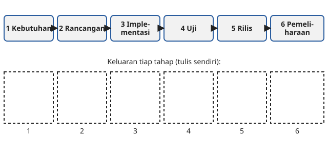

**Ingat dulu:** Dari ingatan, tanpa catatan.

1. Mengapa fungsi penghasil langkah dipisah dari kode penggambaran? ______
2. Apa yang terjadi bila dua orang mengubah baris yang sama di cabang berbeda lalu digabung, dan langkah apa yang menyelesaikannya? ______



`[Gambar: enam kotak berpanah: Kebutuhan, Rancangan, Implementasi, Uji, Rilis, Pemeliharaan. Di bawah tiap kotak ada kotak putus-putus kosong untuk menulis keluaran tahap itu.]`

**Prediksi:** `AI: tanpa AI`. Kriteria penerimaan disimpan sebagai data lalu dihitung. Tebak dulu, tulis, baru jalankan.

```js
const kriteria = [
  { teks: "Tugas baru muncul di daftar", lulus: true },
  { teks: "Tugas selesai bisa dicoret", lulus: true },
  { teks: "Daftar tersimpan setelah halaman dimuat ulang", lulus: false },
];

const lulus = kriteria.filter((k) => k.lulus).length;
console.log(`${lulus} dari ${kriteria.length} kriteria terpenuhi`);
for (const k of kriteria) {
  if (!k.lulus) console.log("Belum: " + k.teks);
}
```

Dua baris yang tercetak: ______

**Lengkapi:** Cerita pengguna dan satu kriteria penerimaan untuk fitur "mencoret tugas selesai". Isi juga kolom keluaran pada gambar.

```text
Sebagai ____, saya ingin mencoret tugas yang sudah selesai, agar ____.
Diberikan daftar berisi tugas "Laporan", ketika ____, maka "Laporan" tampil dengan coretan.
```

**Susun:** `AI: tanpa AI`. Susun baris menjadi fungsi `persenTerpenuhi` yang mengembalikan 0 sampai 100.

```text
A. }
B. return (lulus / kriteria.length) * 100;
C. function persenTerpenuhi(kriteria) {
D. const lulus = kriteria.filter((k) => k.lulus).length;
```

Urutan: ______ , ______ , ______ , ______

**Latihan:**

1. `AI: boleh` Pilih aplikasi kecil karangan (misalnya peminjaman buku kelas). Tulis tiga cerita pengguna dengan satu pengguna fiktif tiap cerita. ______
2. `AI: boleh` Untuk satu cerita, tulis tiga kriteria penerimaan berbentuk "diberikan, ketika, maka" dan sebut mana yang bisa diperiksa dengan program. ______
3. `AI: tanpa AI` Urutkan: rilis versi 1.0, tulis kriteria penerimaan, jalankan uji, tulis cerita pengguna, implementasi di cabang. Tahap mana yang boleh kembali ke tahap sebelumnya, dan mengapa? ______

**Cek diri:**

- [ ] Saya dapat menyebut tahap alur dari kebutuhan sampai pemeliharaan.
- [ ] Saya dapat menulis cerita pengguna dan kriteria penerimaan yang bisa diperiksa.
- [ ] Saya dapat menjelaskan mengapa perubahan di tahap akhir lebih mahal.

**Catatan cetak (untuk guru, tidak dicetak):** satu lembar A4. Kunci ada di modul `b-xi1-m1` bagian "Kunci dan petunjuk". Lembar tidak memuat kolom identitas.
