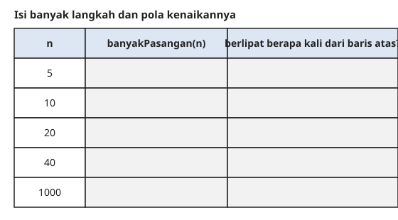

**Ingat dulu:** Tanpa melihat catatan, jawab. (1) Beri contoh data yang membuat strategi greedy untuk menukar uang tidak optimal, dan jelaskan mengapa satu contoh tandingan cukup membantah strategi itu. (2) Mengapa `toEqual` dipakai untuk membandingkan array, bukan `toBe`? (3) Apa yang dikerjakan `tsc --noEmit`?

1. ______
2. ______
3. ______



`[Gambar: tabel tiga kolom: n, banyakPasangan(n), dan "berlipat berapa kali dari baris atas?". Lima baris n tertulis: 5, 10, 20, 40, 1000. Dua kolom lain kosong. Dipakai pada Prediksi dan Latihan 1.]`

**Prediksi:** `AI: tanpa AI`. Tebak dulu, tulis jawabanmu pada tabel di gambar, baru jalankan.

```ts
function banyakPasangan(n: number): number {
  let hitung = 0;
  for (let i = 0; i < n; i++) {
    for (let j = i + 1; j < n; j++) {
      hitung++;
    }
  }
  return hitung;
}
console.log(banyakPasangan(10), banyakPasangan(20), banyakPasangan(40));
```

Setiap `n` berlipat dua, hitungannya berlipat berapa kali, kira-kira? ______

**Lengkapi:** Fungsi pengukur yang mengulang pengukuran dan mengambil nilai tengah. Isi bagian kosong.

```ts setengah-jadi
function ukur(fungsi: () => void, ulang = 5): number {
  const waktu: number[] = [];
  for (let i = 0; i < ulang; i++) {
    const mulai = performance.______();
    fungsi();
    waktu.push(performance.now() ______ mulai);
  }
  waktu.sort((a, b) => ______);
  return waktu[Math.floor(ulang / 2)] ?? 0;
}
```

**Susun:** `AI: tanpa AI`. Susun baris (sudah diacak) menjadi `duplikatSet` yang benar. Tulis urutan hurufnya.

```text
(a) lihat.add(nilai);
(b) for (const nilai of data) {
(c) const lihat = new Set<number>();
(d) if (lihat.has(nilai)) return true;
(e) return false;
(f) }
```

Urutan: ______

**Latihan:**

1. `AI: tanpa AI` Berapa hasil `banyakPasangan(5)`? Tebak rumus umumnya, lalu uji untuk `n = 1000`. Isi tabel di gambar. ______
2. `AI: boleh` Ukur bubble sort dan insertion sort milikmu untuk `n = 2000` dan `4000` dengan `ukur`. Tulis tabel dan tiga kalimat kesimpulan yang menyebut data, jumlah pengulangan, dan batasan ukurannya. ______
3. `AI: boleh` Hitung langkah pencarian linear dan biner untuk mencari `999` pada larik `0` sampai `999`. ______
4. `AI: boleh` Tulis dua solusi untuk "adakah dua angka berbeda posisi yang jumlahnya sama dengan target": satu dengan dua perulangan, satu dengan `Map`. Bandingkan langkahnya. ______

**Cek diri:**

- [ ] Saya dapat menghitung langkah sebuah solusi dan menyebut polanya (linear, kuadrat, logaritmik).
- [ ] Saya dapat mengukur waktu dengan `performance.now`, pengulangan, dan median.
- [ ] Saya tidak menyimpulkan dari satu pengukuran.

**Catatan cetak (untuk guru, tidak dicetak):** dua halaman A4. Kunci ada di modul `b-xi1-m10`, bagian "Kunci dan petunjuk". Lembar tidak memuat kolom nama, kelas, tanggal, atau nilai.
