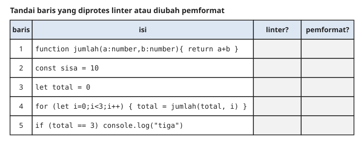

**Ingat dulu:** Tanpa melihat catatan, jawab. (1) Mengapa mengukur waktu satu kali saja tidak cukup untuk membandingkan dua solusi? (2) Mengapa BFS memerlukan catatan "sudah dikunjungi" pada graf yang berputar? (3) Mengapa `pertama<T>(daftar: T[])` mengembalikan `T | undefined`, bukan `T`?

1. ______
2. ______
3. ______



`[Gambar: tabel empat kolom: baris, isi, linter?, dan pemformat?. Lima baris program tertulis: function jumlah(a:number,b:number){ return a+b }, const sisa = 10, let total = 0, for (let i=0;i<3;i++) { total = jumlah(total, i) }, dan if (total == 3) console.log("tiga"). Dua kolom terakhir kosong. Dipakai pada Prediksi.]`

**Prediksi:** `AI: tanpa AI`. Linter membaca kode tanpa menjalankannya dan menandai yang mencurigakan; pemformat hanya mengatur tata letak tanpa mengubah arti. Tebak dulu, tulis jawabanmu pada tabel di gambar, baru jalankan.

```ts
function jumlah(a:number,b:number){ return a+b }
const sisa = 10
let total = 0
for (let i=0;i<3;i++) { total = jumlah(total, i) }
if (total == 3) console.log("tiga")
```

Apa yang tercetak bila program dijalankan? ______

Tulis dua hal yang akan diprotes pemeriksa kode karena mencurigakan (bukan sekadar rapi), dan satu hal yang akan diubah pemformat: ______

**Lengkapi:** Skrip agar `bun run cek` memeriksa tipe, linter, dan uji sekaligus. Isi bagian kosong.

```json setengah-jadi
"scripts": {
  "typecheck": "______ --noEmit",
  "lint": "biome ______ src",
  "test": "bun ______",
  "cek": "bun run typecheck && bun run lint && bun run ______"
}
```

**Susun:** `AI: tanpa AI`. Susun langkah (sudah diacak) untuk memasang linter di proyek baru. Tulis urutan hurufnya.

```text
(a) bunx biome lint src
(b) bun init
(c) bunx biome init
(d) bun add -d @biomejs/biome
(e) baca alasan tiap temuan sebelum memperbaiki
```

Urutan: ______

**Latihan:**

1. `AI: tanpa AI` Ubah fungsi `function hitung(p: number)` yang menghitung ongkos kirim (tarif dasar 8000 ditambah 2500 per kilogram penuh di atas 1 kilogram) menjadi kode terbaca: nama jelas, konstanta bernama, dan satu komentar yang menjelaskan alasan. ______
2. `AI: boleh` Pasang Biome di proyek strategi dari `b-xi1-m9`, jalankan linter dan pemformat, perbaiki semua temuan, dan catat jumlah temuan sebelum dan sesudah beserta alasan tiap perbaikan. ______
3. `AI: tanpa AI` Tebak keluaran `console.log(0 == "", "1" == 1, null == undefined)` dan versi `===`, lalu jalankan. ______
4. `AI: boleh` Pilih satu aturan Biome yang kamu temui, cari penjelasannya di dokumentasi, dan tulis contoh kode yang melanggar dan yang benar. ______

**Cek diri:**

- [ ] Saya dapat menjelaskan beda linter dan pemformat.
- [ ] Saya membaca alasan temuan sebelum memperbaikinya.
- [ ] Saya menjalankan `bun run cek` sebelum menyerahkan kode.

**Catatan cetak (untuk guru, tidak dicetak):** dua halaman A4. Kunci ada di modul `b-xi1-m11`, bagian "Kunci dan petunjuk". Lembar tidak memuat kolom nama, kelas, tanggal, atau nilai.
