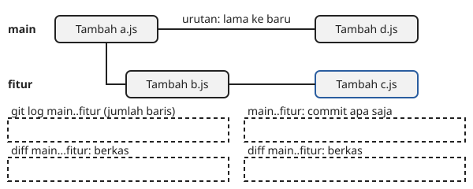

**Ingat dulu:** Tanpa melihat catatan, jawab.

1. Apa beda linter dan pemformat, dan beri satu contoh pekerjaan masing-masing? ______
2. Mengapa `bun run` tetap menjalankan program yang ditolak `tsc`? ______



`[Gambar: dua jalur commit. Jalur main: Tambah a.js lalu Tambah d.js. Jalur fitur bercabang dari Tambah a.js: Tambah b.js lalu Tambah c.js. Di bawah ada empat kotak putus-putus untuk jawaban Prediksi.]`

**Prediksi:** `AI: tanpa AI`. Riwayat pada gambar dibuat dengan perintah di modul (folder kosong, `git init -b main`, satu commit per berkas). Tebak dulu, tulis di kotak gambar, baru jalankan.

```sh
git log --oneline main..fitur
git diff --stat main...fitur
git diff --stat main..fitur
```

Beda keluaran dua perintah `git diff --stat` terakhir: ______

**Lengkapi:** Peninjau ingin melihat daftar commit dan perubahan cabang `fitur-x` sejak bercabang dari `main`, lalu menggabungkannya dengan commit gabungan.

```text setengah-jadi
git ____ --oneline main..origin/fitur-x
git diff main____origin/fitur-x
git merge ____ origin/fitur-x -m "Gabung fitur-x"
```

**Susun:** Urutkan langkah satu fitur dari penulis sampai gabung. `AI: tanpa AI`

```text
A. git push -u origin fitur-x
B. git switch -c fitur-x
C. git commit -am "Tambah fitur x"
D. git fetch lalu git diff main...origin/fitur-x
E. perbaiki sesuai ulasan, commit, push
F. git switch main lalu git merge --no-ff origin/fitur-x
```

Urutan: ______ , ______ , ______ , ______ , ______ , ______

**Latihan:**

1. `AI: tanpa AI` Berkas permintaan penggabungan fiktif ("semua kasus sudah diuji"):

   ```ts
   export function nilaiTertinggi(data: number[]): number {
     let tertinggi = 0;
     for (let i = 0; i <= data.length; i++) {
       if (data[i] > tertinggi) tertinggi = data[i];
     }
     return tertinggi;
   }

   export function urutkanNilai(data: number[]): number[] {
     return data.sort();
   }
   ```

   Tulis ulasan (temuan, alasan, saran) untuk sedikitnya dua masalah: ______
2. `AI: tanpa AI` Jelaskan dengan kata-katamu beda `main..fitur` dan `main...fitur` untuk `git diff`: ______
3. `AI: boleh` Tiga bagian satu komentar ulasan yang baik, dan satu hal yang wajib dicek bila kodenya buatan AI: ______

**Cek diri:**

- [ ] Saya dapat menjelaskan alur cabang, permintaan penggabungan, ulasan, dan gabung.
- [ ] Saya menulis komentar berisi temuan, alasan, dan saran.
- [ ] Saya menjalankan dan menguji kode sebelum menyetujuinya, termasuk kode buatan AI.

**Catatan cetak (untuk guru, tidak dicetak):** satu lembar A4 (dua halaman bila diisi besar). Kunci ada di modul `b-xi1-m12` bagian "Kunci dan petunjuk". Lembar tidak memuat kolom identitas.
