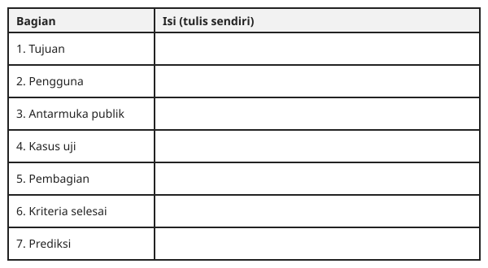

**Ingat dulu:** Tanpa melihat catatan, jawab.

1. Apa beda `git diff main..fitur` dan `git diff main...fitur`, dan mana yang dipakai peninjau untuk melihat isi cabang? ______
2. Apa yang dimaksud solusi "kuadrat", dan apa yang terjadi pada waktunya bila `n` berlipat dua? ______
3. Mengapa `node_modules` tidak dimasukkan ke Git, dan bagaimana temanmu mendapatkannya? ______



`[Gambar: tabel dua kolom, tujuh baris: Tujuan, Pengguna, Antarmuka publik, Kasus uji, Pembagian, Kriteria selesai, Prediksi. Kolom isi kosong. Kelompokmu mengisinya sebelum mengetik kode.]`

**Prediksi:** Pustaka `pustaka-antrian` punya enam uji (tiga untuk `Antrian`, tiga untuk `Tumpukan`). Lulus semua pada percobaan pertama? Tulis tebakanmu dan alasannya, lalu bandingkan setelah `bun test`: ______

**Lengkapi:** Kelas generik bertipe. `T` ditentukan pemakai, dan kembalian `T | undefined` memaksa pemakai menangani antrian kosong.

```ts setengah-jadi
export class Antrian<____> {
  private isi: T[] = [];

  masuk(nilai: T): void {
    this.isi.push(nilai);
  }

  keluar(): T | undefined {
    return this.isi.______();
  }

  depan(): T | undefined {
    return this.isi[__];
  }
}
```

**Latihan:**

1. `AI: boleh` Tulis rencana satu halaman pustaka kelompokmu (topik: statistik, alat teks, atau graf) di tabel pada gambar. Syarat minimal: tiga fungsi atau kelas publik, sedikitnya dua uji tiap satu, tanpa `any`, README berisi contoh pemakaian.
2. Mengapa pustaka memakai `Antrian<T>` dan bukan `any`? ______
3. Apa isi `index.ts` sebuah pustaka dan mengapa berkas itu ada? ______
4. `AI: boleh` Sebutkan tiga pemeriksaan yang harus lulus sebelum pustaka diserahkan: ______
5. `AI: boleh` Sertakan keluaran `bun run cek` pada keterangan permintaan penggabungan. Apa yang diyakinkan peninjau dari keluaran itu, dan apa yang tidak? ______

**Cek diri:**

- [ ] Saya dapat menulis rencana pustaka: pengguna, antarmuka, kasus uji, pembagian tugas.
- [ ] Saya dapat menulis kelas generik bertipe dan menjelaskan manfaatnya.
- [ ] Saya menjalankan tipe, linter, dan uji sebelum menyerahkan.

**Catatan cetak (untuk guru, tidak dicetak):** satu lembar A4. Kunci ada di modul `b-xi1-m13` bagian "Kunci dan petunjuk". Lembar tidak memuat kolom identitas.
