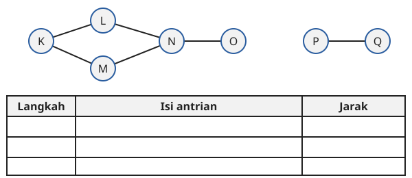

**Ingat dulu:** Dari ingatan, tanpa catatan.

1. Apa kegunaan `index.ts` sebagai pintu depan paket, dan apa akibatnya pada fungsi yang tidak diekspor? ______
2. Apa yang disimpan memoisasi, dan di mana catatannya harus dibuat agar bekerja? ______
3. Mengapa `===` lebih aman daripada `==`? Beri satu contoh. ______



`[Gambar: graf dengan simpul K, L, M, N, O, P, Q dan sisi K-L, K-M, L-N, M-N, N-O, P-Q. Di bawahnya tabel kosong berkolom Langkah, Isi antrian, Jarak untuk menelusuri BFS dari K.]`

**Lengkapi:** Penelusuran BFS dari `K` memakai graf pada gambar. Isi tabel: isi antrian dan jarak tiap simpul pada tiap langkah. Jarak ke `Q`: ______

**Latihan:** `AI: tanpa AI`, dalam waktu yang ditetapkan gurumu.

1. Tulis `hitungKata(teks: string): Map<string, number>` yang mengubah teks ke huruf kecil, memisahkannya pada spasi, mengabaikan kata kosong, dan menghitung tiap kata. Hasil untuk `"Aku suka kopi aku suka teh"`: ______
2. Koin 1, 4, 6, target 8: koin hasil greedy ______, koin optimal ______, kesimpulanmu tentang greedy untuk koin ini: ______
3. Mencari adakah dua angka sama di 2000 data: langkah solusi dua perulangan ______, solusi `Set` ______. Tulis empat langkah rencana pengukuran waktu yang adil: ______
4. Tulis tiga komentar ulasan (temuan, alasan, saran):

   ```ts
   function persen(bagian: number, total: number): number {
     return (bagian / total) * 100;
   }

   function terbesar(daftar: number[]): number {
     daftar.sort();
     return daftar[daftar.length - 1];
   }
   ```

   Komentar: ______

**Cek diri:**

- [ ] Saya dapat menelusuri BFS dan membaca jaraknya.
- [ ] Saya dapat menunjukkan kapan greedy gagal dan menyebut alternatifnya.
- [ ] Saya dapat menulis ulasan berisi temuan, alasan, dan saran.

**Catatan cetak (untuk guru, tidak dicetak):** satu lembar A4. Kunci ada di modul `b-xi1-m14` bagian "Kunci dan petunjuk". Lembar tidak memuat kolom identitas atau refleksi yang dikumpulkan.
