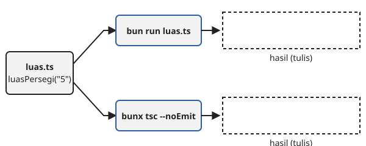

**Ingat dulu:** Dari ingatan, tanpa catatan.

1. Sebutkan lima tahap alur pengembangan produk digital sesuai urutannya. ______
2. Apa yang dikerjakan `setTimeout`, dan bagaimana membatalkan timer yang masih menunggu? ______



`[Gambar: berkas luas.ts berisi pemanggilan luasPersegi("5") dengan dua panah: ke "bun run luas.ts" dan ke "bunx tsc --noEmit". Di ujung tiap panah ada kotak putus-putus kosong untuk menulis hasilnya.]`

**Prediksi:** `AI: tanpa AI`. Perhatikan tipe `number` pada parameter, lalu argumen yang diberikan. Tebak dulu, tulis di kotak gambar, baru jalankan.

```ts
function luasPersegi(sisi: number): number {
  return sisi * sisi;
}

console.log(luasPersegi("5"));
```

Menurutmu `tsc` melaporkan sesuatu pada berkas ini? Alasan: ______

**Lengkapi:** Tipe agar fungsi menerima nama dan jumlah, lalu mengembalikan teks.

```ts setengah-jadi
function salam(nama: ____, jumlah: ____): ____ {
  return nama + " punya " + jumlah + " buku";
}
console.log(salam("Dewi", 3));
```

**Susun:** `AI: tanpa AI`. Susun baris menjadi fungsi bertipe yang mengembalikan apakah `n` genap.

```text
A. return n % 2 === 0;
B. }
C. function genap(n: number): boolean {
```

Urutan: ______ , ______ , ______

**Latihan:**

1. `AI: tanpa AI` Pada kode ini, tebak dulu tiga galat yang akan dilaporkan `tsc`, lalu tuliskan baris dan alasannya: ______

   ```ts
   function rataRata(nilai: number[]): number {
     let jumlah = 0;
     for (const n of nilai) {
       jumlah += n;
     }
     return jumlah / nilai.length;
   }

   const nilaiKelas: number[] = [80, 75, "90"];
   const hasil: string = rataRata(nilaiKelas);
   console.log(rataRata(80, 75));
   ```

2. `AI: tanpa AI` Tulis tanda tangan fungsi `terbesar` (menerima array angka, mengembalikan angka) sebelum menulis badannya: ______
3. `AI: boleh` Buat satu galat tipe, jalankan dengan `bun run` dan dengan `tsc`, dan jelaskan mengapa hasilnya berbeda: ______

**Cek diri:**

- [ ] Saya dapat menjelaskan apa yang diperiksa `tsc` dan apa yang dijalankan `bun run`.
- [ ] Saya dapat membaca satu pesan galat tipe: berkas, baris, kode, dan alasannya.
- [ ] Saya dapat menulis tipe dasar dan array pada variabel dan fungsi.

**Catatan cetak (untuk guru, tidak dicetak):** satu lembar A4. Kunci ada di modul `b-xi1-m2` bagian "Kunci dan petunjuk". Lembar tidak memuat kolom identitas.
