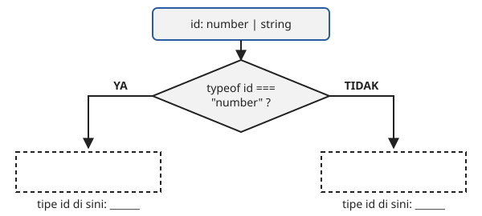

**Ingat dulu:** Dari ingatan, tanpa catatan.

1. Tulis tanda tangan fungsi `jumlah` yang menerima dua `number` dan mengembalikan `number`. ______
2. Mengapa `[10, 9, 1].sort()` tanpa pembanding memberi hasil yang mengejutkan, dan bagaimana memperbaikinya? ______



`[Gambar: kotak "id: number | string" menuju pertanyaan "typeof id === "number"?". Cabang YA dan cabang TIDAK masing-masing menuju kotak putus-putus kosong untuk menulis tipe id di cabang itu.]`

**Prediksi:** `AI: tanpa AI`. Tipe `Id` boleh angka atau teks. Tebak dulu, tulis, baru jalankan.

```ts
type Id = number | string;

function tampil(id: Id): string {
  if (typeof id === "number") {
    return "No. " + id.toFixed(0);
  }
  return "Kode " + id.toUpperCase();
}

console.log(tampil(7));
console.log(tampil("ab-1"));
```

Dua baris yang tercetak: ______

Bila `id.toUpperCase()` ditulis di luar `if` dan di atas `return` pertama, apakah `tsc` menerimanya? Mengapa? ______

**Lengkapi:** Modelkan satu pengguna karangan dengan `interface` dan satu fungsi yang menyapanya.

```ts setengah-jadi
interface Siswa {
  sebutan: ____;
  kelas: ____ | ____;
}
function sapa(s: Siswa): string {
  return "Halo, " + s.sebutan + " (kelas " + s.kelas + ")";
}
console.log(sapa({ sebutan: "Dewi-contoh", kelas: 11 }));
```

**Susun:** `AI: tanpa AI`. Susun baris menjadi fungsi `terakhir` yang generik.

```text
A. return daftar[daftar.length - 1];
B. function terakhir<T>(daftar: T[]): T | undefined {
C. }
```

Urutan: ______ , ______ , ______

**Latihan:**

1. `AI: tanpa AI` Tulis perbaikan tiap objek agar lolos `tsc`, tanpa mengubah tipenya: ______

   ```ts
   type Status = "tersedia" | "dipinjam";

   interface Buku {
     judul: string;
     tahun: number;
     status: Status;
   }

   const a: Buku = { judul: "Dasar Web", tahun: 2022 };
   const b: Buku = { judul: "Peta", tahun: 2019, status: "rusak" };
   const c: Buku = { judul: "Array", tahun: "2024", status: "tersedia" };
   console.log(a, b, c);
   ```

2. `AI: tanpa AI` Tulis tipe `Pembayaran` yang bisa berupa `{ jenis: "tunai"; jumlah: number }` atau `{ jenis: "transfer"; jumlah: number; bank: string }`, sebelum menulis fungsi `ringkas(p)`: ______
3. `AI: boleh` Tulis `ambilSemua<T>(daftar: T[], ukuran: number): T[]` yang mengembalikan `ukuran` elemen pertama, lalu jalankan dengan angka dan dengan teks: ______

**Cek diri:**

- [ ] Saya dapat menulis `interface` dan `type` untuk data berbentuk objek.
- [ ] Saya dapat memakai tipe literal dan gabungan, termasuk penyempitannya.
- [ ] Saya dapat menjelaskan `T[]` dan fungsi generik sederhana.

**Catatan cetak (untuk guru, tidak dicetak):** satu sampai dua halaman A4. Kunci ada di modul `b-xi1-m3` bagian "Kunci dan petunjuk". Lembar tidak memuat kolom identitas.
