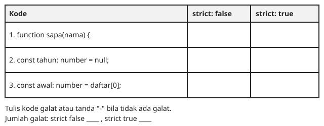

**Ingat dulu:** Dari ingatan, tanpa catatan.

1. Apa beda `interface` dan tipe literal seperti `"tersedia" | "dipinjam"`? Beri satu kegunaan masing-masing. ______
2. Tulis satu cerita pengguna dan satu kriteria penerimaan yang bisa diperiksa untuk fitur "menambah tugas". ______



`[Gambar: tabel berkolom Kode, strict: false, strict: true, dengan tiga baris dari kacau.ts: parameter nama tanpa tipe, tahun bertipe number diisi null, awal bertipe number diisi daftar[0]. Kolom galat kosong untuk diisi.]`

**Prediksi:** `AI: tanpa AI`. Isi tabel pada gambar sebelum menjalankan `tsc`. Berkas lengkapnya:

```ts
function sapa(nama) {
  return "Halo, " + nama;
}

const tahun: number = null;
const daftar: number[] = [3, 1, 2];
const awal: number = daftar[0];

console.log(sapa("Dewi"), tahun, awal);
```

Apa yang tercetak bila dijalankan dengan `bun run kacau.ts`? ______

**Lengkapi:** `tsconfig.json` agar `tsc` hanya memeriksa, tidak menulis berkas, dan memakai mode ketat.

```text setengah-jadi
{
  "compilerOptions": {
    "strict": ____,
    "noEmit": ____
  },
  "include": ["____"]
}
```

**Susun:** `AI: tanpa AI`. Susun baris menjadi fungsi yang mengembalikan elemen pertama atau teks cadangan bila array kosong.

```text
A. return awal ?? "kosong";
B. const awal = daftar[0];
C. function elemenPertama(daftar: string[]): string {
D. }
```

Urutan: ______ , ______ , ______ , ______

**Latihan:**

1. `AI: tanpa AI` Tulis tanda tangan fungsi `rataRataAman` yang mengembalikan `number | null` bila array kosong, sebelum menulis badannya: ______
2. `AI: boleh` Nyalakan `strict` dan `noUncheckedIndexedAccess` pada skrip dari modul sebelumnya, lalu perbaiki semua galat tanpa memakai `any` atau `as`.
3. `AI: boleh` Matikan `strict`, jalankan `tsc`, lalu nyalakan lagi. Tulis tiga hal yang berubah dan satu risiko mematikannya: ______
4. `AI: boleh` Tulis kriteria penerimaan untuk keputusan tim "kode tidak digabung bila `tsc` melaporkan galat": ______

**Cek diri:**

- [ ] Saya dapat menulis `tsconfig.json` kecil dan menjelaskan `strict`, `noEmit`, dan `include`.
- [ ] Saya dapat menjelaskan mengapa `bun run` tidak menggantikan `tsc`.
- [ ] Saya menjalankan `tsc` sebelum menggabungkan kode.

**Catatan cetak (untuk guru, tidak dicetak):** satu sampai dua halaman A4. Kunci ada di modul `b-xi1-m4` bagian "Kunci dan petunjuk". Lembar tidak memuat kolom identitas.
