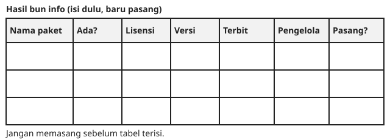

**Ingat dulu:** Dari ingatan, tanpa catatan.

1. Apa yang dikerjakan `"strict": true` pada `tsconfig.json`, dan satu galat yang muncul karenanya? ______
2. Mengapa jawaban yang meyakinkan, termasuk dari AI, tetap harus dijalankan dan diuji? ______



`[Gambar: tabel dengan kolom Nama paket, Ada?, Lisensi, Versi, Terbit, Pengelola, Pasang? dan tiga baris kosong. Isi dari hasil bun info untuk tiga nama paket yang disiapkan gurumu.]`

**Prediksi:** `AI: tanpa AI`. Berkas `versi.ts` memakai objek `Bun` dan daftar argumen proses.

```ts
console.log("Bun", Bun.version);
console.log(process.argv.length);
```

Apa yang tercetak untuk `bun run versi.ts`, dan untuk `bun run versi.ts a b`? ______

Mengapa `tsc` bisa melaporkan `Cannot find name 'Bun'` bila paket `@types/bun` tidak terpasang? ______

**Lengkapi:** Perintah agar proyek baru dibuat tanpa pertanyaan, paket `nanoid` ditambahkan, lalu skrip pemeriksa tipe dijalankan.

```text setengah-jadi
bun ____ -y
bun ____ nanoid
bun run ____
```

**Susun:** `AI: tanpa AI`. Urutkan langkah untuk temanmu yang baru meng-clone repositori proyek.

```text
A. bun run index.ts
B. git clone <alamat repositori>
C. bun install
D. cd proyek
```

Urutan: ______ , ______ , ______ , ______

**Latihan:**

1. `AI: tanpa AI` Sebut paket mana yang masuk `dependencies` dan mana `devDependencies` pada proyek hasil `bun init -y` yang kemudian ditambah `nanoid`, dan berkas apa yang mencatat versi pastinya: ______
2. `AI: boleh` Buat proyek dengan `bun init -y`, tambah `nanoid`, tulis skrip yang membuat tiga ID dan mencetak panjangnya, lalu jalankan `bun run typecheck`.
3. `AI: boleh` Untuk tiga nama paket dari gurumu, jalankan `bun info <nama>` dan isi tabel pada gambar, lalu putuskan memasang atau tidak.
4. `AI: tanpa AI` Tulis dengan kata-katamu empat langkah menerima nama paket dari asisten AI sampai memasangnya: ______

**Cek diri:**

- [ ] Saya dapat membuat proyek dengan `bun init` dan membaca `package.json`.
- [ ] Saya dapat menjelaskan peran `bun.lock` dan alasan `node_modules` di luar Git.
- [ ] Saya memeriksa keberadaan dan reputasi paket dengan `bun info` sebelum memasang.

**Catatan cetak (untuk guru, tidak dicetak):** satu sampai dua halaman A4. Guru menyiapkan tiga nama paket untuk Latihan 3. Kunci ada di modul `b-xi1-m5` bagian "Kunci dan petunjuk". Lembar tidak memuat kolom identitas.
