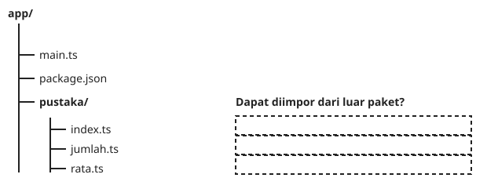

**Ingat dulu:** Dari ingatan, tanpa catatan.

1. Apa beda `dependencies` dan `devDependencies`, dan berkas mana yang mencatat versi pasti yang terpasang? ______
2. Apa beda `git fetch` dan `git pull`? ______



`[Gambar: folder app berisi main.ts, package.json, dan pustaka. Folder pustaka berisi index.ts, jumlah.ts, rata.ts. Di kanan tiga berkas pustaka ada kotak putus-putus kosong untuk menulis apa yang dapat diimpor dari luar paket.]`

**Prediksi:** `AI: tanpa AI`. `cetak.ts` mencetak sesuatu saat dimuat; `dua.ts` mengimpornya dua kali.

```ts
console.log("modul dimuat");
export const x = 1;
```

```ts
import "./cetak.ts";
import { x } from "./cetak.ts";
console.log(x);
```

Berapa kali "modul dimuat" tercetak bila `dua.ts` dijalankan dengan `bun run dua.ts`, dan mengapa? ______

**Lengkapi:** Berkas yang mengekspor satu fungsi bernama dan satu nilai `default`.

```ts setengah-jadi
export ____ function kuadrat(n: number): number {
  return n * n;
}

____ ____ function kubik(n: number): number {
  return n * n * n;
}
```

**Susun:** `AI: tanpa AI`. Susun baris menjadi `main.ts` yang memakai paket dan mencetak jumlah.

```text
A. const nilai = [1, 2, 3];
B. import { jumlah } from "statistik-kelas";
C. console.log(jumlah(nilai));
```

Urutan: ______ , ______ , ______

**Latihan:**

1. `AI: tanpa AI` Isi kotak pada gambar, lalu tulis satu impor yang akan ditolak: ______
2. `AI: boleh` Buat paket lokal `alat-teks` dengan dua fungsi bernama, pintu depan `index.ts`, dan `package.json`. Pasang ke proyek lain dengan `bun add` dan jalankan.
3. `AI: tanpa AI` Gambar di kertas folder paketmu dan tulis fungsi mana yang diekspor dan mana yang tertutup, sebelum menulis kode.
4. `AI: boleh` Tambah `export interface` pada paketmu dan impor dengan `import type` di proyek pemakai; periksa dengan `bun check`.

**Cek diri:**

- [ ] Saya dapat membedakan ekspor bernama dan bawaan.
- [ ] Saya dapat membuat paket lokal dan memasangnya dengan `bun add`.
- [ ] Saya dapat menjelaskan fungsi `index.ts` dan fungsi yang tertutup.

**Catatan cetak (untuk guru, tidak dicetak):** satu sampai dua halaman A4. Kunci ada di modul `b-xi1-m6` bagian "Kunci dan petunjuk". Lembar tidak memuat kolom identitas.
