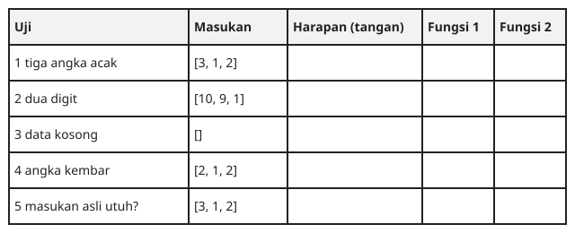

**Ingat dulu:** Dari ingatan, tanpa catatan.

1. Apa beda ekspor bernama dan ekspor bawaan, dan bagaimana masing-masing diimpor? ______
2. Mengapa `daftar[0]` bertipe `number | undefined` bila `noUncheckedIndexedAccess` menyala? ______
3. Mengapa menguji dengan masukan kecil yang jawabannya sudah dihitung sebelum menjalankan program? ______



`[Gambar: tabel berkolom Uji, Masukan, Harapan (tangan), Fungsi 1, Fungsi 2 dengan lima baris: tiga angka acak [3, 1, 2]; dua digit [10, 9, 1]; data kosong []; angka kembar [2, 1, 2]; masukan asli utuh [3, 1, 2]. Kolom harapan dan hasil kosong.]`

**Prediksi:** `AI: tanpa AI`. Dua fungsi `urutNaik` dipasang bergantian pada lima uji pada gambar. Hitung harapan dengan tangan, lalu tulis "lulus" atau "gagal" untuk tiap fungsi sebelum menjalankan `bun test`.

```ts
export function urutNaik(data: number[]): number[] {
  return [...data].sort();
}
```

```ts
export function urutNaik(data: number[]): number[] {
  const hasil: number[] = [];
  for (const n of data) {
    const posisi = hasil.findIndex((x) => x > n);
    hasil.splice(posisi === -1 ? hasil.length : posisi, 0, n);
  }
  return hasil;
}
```

Keluaran kedua fungsi untuk `[10, 9, 1]`: ______

**Lengkapi:** Dua uji untuk fungsi `jumlah`: kasus kosong harus 0, dan `[2, 3]` harus 5.

```ts setengah-jadi
import { expect, test } from "bun:test";
import { jumlah } from "./jumlah.ts";

test("jumlah array kosong", () => {
  expect(jumlah([])).____(0);
});

test("jumlah dua angka", () => {
  expect(jumlah([2, 3])).____(____);
});
```

**Susun:** `AI: tanpa AI`. Susun baris menjadi satu uji yang lengkap.

```text
A. });
B. expect(urutNaik([2, 1])).toEqual([1, 2]);
C. test("dua angka terbalik", () => {
D. import { expect, test } from "bun:test";
```

Urutan: ______ , ______ , ______ , ______

**Latihan:**

1. `AI: tanpa AI` Tulis dulu di kertas keluaran `urutNaik` untuk `[5, 5, 1, 0]`, lalu tambahkan sebagai uji dan jalankan: ______
2. `AI: tanpa AI` Sebelum menulis `maksimum(nilai: number[])`, tulis daftar kasus uji dan hasil harapannya, termasuk array kosong, dan putuskan apa yang seharusnya terjadi bila kosong: ______
3. `AI: boleh` Ubah fungsi pengurutanmu agar satu uji gagal, baca keluarannya, dan tulis tiga hal yang kamu pelajari: ______
4. Apa yang dibuktikan dan tidak dibuktikan oleh uji yang lolos semua? ______

**Cek diri:**

- [ ] Saya dapat menulis uji `bun test` dengan `describe`, `test`, dan `expect`.
- [ ] Saya menghitung harapan dengan tangan sebelum menjalankan program.
- [ ] Saya dapat menjelaskan mengapa `toEqual` dipakai untuk array.

**Catatan cetak (untuk guru, tidak dicetak):** satu sampai dua halaman A4. Kunci ada di modul `b-xi1-m7` bagian "Kunci dan petunjuk". Lembar tidak memuat kolom identitas.
