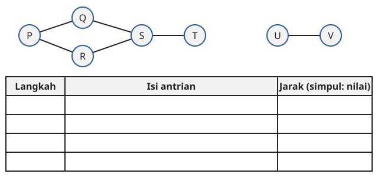

**Ingat dulu:** Dari ingatan, tanpa catatan.

1. Apa fungsi `test`, `describe`, dan `expect` pada berkas `*.test.ts`? ______
2. Apa beda LIFO dan FIFO? Beri satu contoh sehari-hari untuk tiap-tiapnya. ______



`[Gambar: graf dengan simpul P, Q, R, S, T, U, V dan sisi P-Q, P-R, Q-S, R-S, S-T, U-V. Di bawahnya tabel kosong berkolom Langkah, Isi antrian, Jarak untuk menelusuri BFS dari P.]`

**Prediksi:** `AI: tanpa AI`. Tebak dulu, tulis, baru jalankan.

```ts
const hitung = new Map<string, number>();
for (const kata of ["a", "b", "a", "c", "a", "b"]) {
  hitung.set(kata, (hitung.get(kata) ?? 0) + 1);
}
console.log([...hitung]);
console.log(new Set(["a", "b", "a"]).size);
```

Isi `hitung` pada akhirnya dan urutannya: ______  Ukuran `Set` pada baris terakhir dan alasannya: ______

**Lengkapi:** Jumlah teman dan teman bersama dua orang, dengan peta ketetanggaan sebagai parameter.

```ts setengah-jadi
function jumlahTeman(peta: Map<string, Set<string>>, nama: string): ____ {
  return (peta.get(nama) ?? new Set()).____;
}

function temanBersama(
  peta: Map<string, Set<string>>,
  a: string,
  b: string,
): string[] {
  const milikB = peta.get(b) ?? new ____<string>();
  return [...(peta.get(a) ?? [])].filter((t) => milikB.____(t));
}
```

**Susun:** `AI: tanpa AI`. Susun baris menjadi isi perulangan BFS yang benar.

```text
A. const sekarang = antrian.shift();
B. antrian.push(t);
C. while (antrian.length > 0) {
D. if (!jarak.has(t)) {
E. jarak.set(t, jarakSekarang + 1);
F. for (const t of this.teman(sekarang)) {
```

Urutan: ______ , ______ , ______ , ______ , ______ , ______

**Latihan:**

1. `AI: tanpa AI` Telusuri BFS dari `P` pada graf di gambar: isi tabel antrian dan jarak tiap langkah. Jarak ke `T`: ______ Jarak ke `U`: ______
2. `AI: boleh` Tulis `frekuensi(teks: string): Map<string, number>` yang menghitung tiap huruf, lalu cetak terurut dari yang terbanyak untuk `"mississippi"` (huruf sama banyak urut abjad).
3. `AI: boleh` Tulis `orangTerpopuler(peta)` yang mengembalikan nama dengan teman terbanyak (seri: nama pertama menurut abjad).
4. `AI: boleh` Tulis pseudocode dulu, lalu kode `banyakKelompok(peta)` yang menghitung berapa kelompok pertemanan yang saling terpisah.

**Cek diri:**

- [ ] Saya dapat memilih `Map`, `Set`, objek, atau array untuk suatu data dan menjelaskan alasannya.
- [ ] Saya dapat menyimpan graf sebagai daftar ketetanggaan.
- [ ] Saya dapat menelusuri BFS dan membaca jaraknya.

**Catatan cetak (untuk guru, tidak dicetak):** satu sampai dua halaman A4. Kunci ada di modul `b-xi1-m8` bagian "Kunci dan petunjuk". Lembar tidak memuat kolom identitas.
