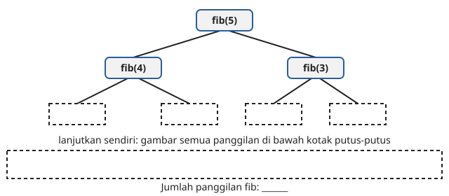

**Ingat dulu:** Dari ingatan, tanpa catatan.

1. Apa fungsi `Set` pada daftar ketetanggaan, dan apa yang terjadi bila `tambahSisi` dipanggil dua kali untuk pasangan yang sama? ______
2. Mengapa sebuah modul ES yang diimpor di dua berkas hanya dijalankan sekali? ______



`[Gambar: akar fib(5) dengan dua anak fib(4) dan fib(3), lalu empat kotak putus-putus kosong di tingkat berikutnya. Lanjutkan pohon sampai semua panggilan tergambar, lalu isi jumlah panggilan.]`

**Prediksi:** `AI: tanpa AI`. Gambar dulu pohon panggilannya pada gambar, baru jalankan.

```ts
let panggilan = 0;

function fib(n: number): number {
  panggilan++;
  return n < 2 ? n : fib(n - 1) + fib(n - 2);
}

console.log(fib(5), panggilan);
```

Nilai `fib(5)`: ______  Berapa kali `fib` dipanggil: ______

**Lengkapi:** Fungsi rekursif `faktorial` (hasil kali 1 sampai `n`, dan `faktorial(0)` adalah 1).

```ts setengah-jadi
function faktorial(n: number): number {
  if (n === ____) return ____;
  return n * faktorial(____);
}
```

**Susun:** `AI: tanpa AI`. Susun baris menjadi `fibMemo` yang benar.

```text
A. const hasil = fibMemo(n - 1, catatan) + fibMemo(n - 2, catatan);
B. if (n < 2) return n;
C. catatan.set(n, hasil);
D. const ada = catatan.get(n);
E. return hasil;
F. if (ada !== undefined) return ada;
```

Urutan: ______ , ______ , ______ , ______ , ______ , ______

**Latihan:**

1. `AI: tanpa AI` Untuk `fibMemo(5)`, tuliskan urutan panggilan dan hitung berapa kali fungsi dipanggil: ______
2. `AI: boleh` Cari tahu apakah greedy optimal untuk koin 1, 6, 10 dan target 12. Tunjukkan dengan program: ______
3. `AI: boleh` Tulis `jumlahDigit(n)` dan `pangkat(basis, eksponen)` secara rekursif. Tulis kasus dasarnya dulu.
4. `AI: boleh` Tulis pseudocode dulu, lalu kode: dari kegiatan `[mulai, selesai]` yang tidak boleh bertabrakan, pilih sebanyak mungkin dengan strategi "pilih yang paling cepat selesai". Uji dengan `[[1, 3], [2, 5], [4, 7], [6, 8], [7, 10], [9, 11]]`.

**Cek diri:**

- [ ] Saya dapat menjelaskan greedy dan memberi contoh tandingan.
- [ ] Saya dapat menulis fungsi rekursif dengan kasus dasar dan menelusurinya.
- [ ] Saya dapat menambahkan memoisasi dengan `Map` dan menjelaskan manfaatnya.

**Catatan cetak (untuk guru, tidak dicetak):** satu sampai dua halaman A4. Kunci ada di modul `b-xi1-m9` bagian "Kunci dan petunjuk". Lembar tidak memuat kolom identitas.
