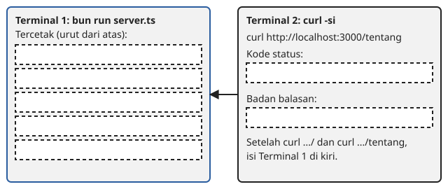

**Ingat dulu:** Dari ingatan, tanpa catatan.

1. Apa beda `bun run berkas.ts` dan pemeriksaan tipe dengan `tsc`? ______
2. Apa yang dibuktikan dan tidak dibuktikan oleh uji yang lolos semua? ______



`[Gambar: dua kotak berdampingan. Terminal 1 menjalankan bun run server.ts dengan lima kotak kosong untuk baris yang tercetak. Terminal 2 menjalankan curl ke /tentang dengan kotak kosong untuk kode status dan badan balasan. Panah dari kanan ke kiri.]`

**Prediksi:** `AI: tanpa AI`. Tebak dulu, tulis di kotak gambar, baru jalankan. Di terminal pertama: `bun run server.ts`. Di terminal kedua: `curl http://localhost:3000/` lalu `curl http://localhost:3000/tentang`.

```ts
const server = Bun.serve({
  hostname: "localhost",
  port: 3000,
  fetch(req) {
    const url = new URL(req.url);
    console.log(req.method, url.pathname);
    if (url.pathname === "/") {
      return new Response("Halo dari server lokal!\n");
    }
    return new Response("Tidak ada halaman ini.\n", { status: 404 });
  },
});

console.log(`Server jalan di ${server.url}`);
```

Bila baris `hostname: "localhost"` dihapus, siapa saja yang bisa menyambung ke server ini? ______

**Lengkapi:** Server yang berjalan hanya di komputermu, memakai port 3000, membalas HTML di `/`, dan membalas jalur lain dengan status 404.

```ts setengah-jadi
Bun.serve({
  ____: "localhost",
  port: 3000,
  fetch(req) {
    const url = new URL(req.url);
    if (url.pathname === "/") {
      return new Response("<h1>Halo</h1>", { headers: { "content-type": "____" } });
    }
    return new Response("Tidak ada.", { ____: 404 });
  },
});
```

**Susun:** `AI: tanpa AI`. Susun baris menjadi server yang membalas "pong" pada `/ping` dan 404 untuk jalur lain.

```text
A.     return new Response("pong\n");
B. const server = Bun.serve({
C.   fetch(req) {
D.     if (new URL(req.url).pathname === "/ping") {
E.     return new Response("tidak ada\n", { status: 404 });
F.   hostname: "localhost",
G.     }
H.   },
I. });
```

Urutan: ______ , ______ , ______ , ______ , ______ , ______ , ______ , ______ , ______

**Latihan:**

1. `AI: boleh` Buat server di `localhost:3000` yang membalas HTML pada `/` (judul, satu paragraf) dan 404 untuk jalur lain. Uji dengan `curl -si` dan peramban, lalu matikan servernya.
2. `AI: boleh` Tambahkan jalur `/salam` yang membalas `Halo, <nama>!` dengan nama dari `?nama=...`, dan `Halo, teman!` bila tidak ada. Pakai nama karangan.
3. `AI: tanpa AI` Jalankan server latihan 1 di dua terminal. Apa yang terjadi di terminal kedua, dan bagaimana memperbaikinya tanpa mematikan server pertama? ______
4. Mengapa balasan "halaman tidak ada" memakai status 404, bukan status 200 dengan teks "tidak ada"? ______

**Cek diri:**

- [ ] Saya dapat menjelaskan bagian-bagian permintaan dan balasan HTTP.
- [ ] Saya selalu menulis `hostname: "localhost"` dan tahu alasannya.
- [ ] Saya dapat membaca galat "port sudah dipakai" dan memperbaikinya.

**Catatan cetak (untuk guru, tidak dicetak):** satu sampai dua halaman A4. Kunci ada di modul `b-xi2-m1` bagian "Kunci dan petunjuk". Lembar tidak memuat kolom identitas.
