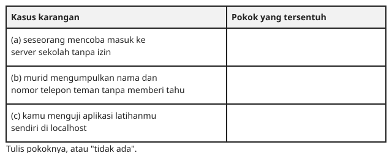

**Ingat dulu:** Dari ingatan, tanpa catatan.

1. Mengapa `await fetch(...)` yang berhasil belum berarti permintaan berhasil, dan apa yang harus diperiksa? ______
2. Mengapa teks dari data dilewatkan `esc` sebelum dimasukkan ke HTML? ______
3. Mengapa badan permintaan dari klien diperlakukan sebagai masukan yang belum dipercaya? ______



`[Gambar: tabel dua kolom, Kasus karangan dan Pokok yang tersentuh. Baris (a) seseorang mencoba masuk ke server sekolah tanpa izin, (b) murid mengumpulkan nama dan nomor telepon teman untuk aplikasi tanpa memberi tahu, (c) menguji aplikasi latihan sendiri di localhost. Kolom kedua kosong.]`

**Prediksi:** `AI: tanpa AI`. Tebak dulu, tulis, baru jalankan.

```ts
function escapeHtml(teks: string): string {
  return teks
    .replaceAll("&", "&amp;")
    .replaceAll("<", "&lt;")
    .replaceAll(">", "&gt;")
    .replaceAll('"', "&quot;")
    .replaceAll("'", "&#39;");
}

function rentan(nama: string): string {
  return `<h1>Halo, ${nama}</h1>`;
}

function aman(nama: string): string {
  return `<h1>Halo, ${escapeHtml(nama)}</h1>`;
}

console.log(rentan("<b>tebal</b>"));
console.log(aman("<b>tebal</b>"));
console.log(aman("Ani & Beni"));
```

Tiga baris yang tercetak: ______  Bila `nama` berasal dari kotak isian pengunjung, mana yang membiarkan HTML tersisip? ______

**Lengkapi:** `escapeHtml`. Urutan penting: `&` diganti lebih dulu.

```ts setengah-jadi
function escapeHtml(teks: string): string {
  return teks
    .replaceAll("&", "____")
    .replaceAll("<", "&lt;")
    .replaceAll(">", "____")
    .replaceAll('"', "&quot;");
}
console.log(escapeHtml("a < b & c"));
```

Mengapa `&` harus diganti paling awal? ______

**Susun:** Susun baris menjadi program pembaca rahasia yang benar. Satu baris tidak terpakai.

```text
A. console.log("kunci terbaca, panjang", kunci.length);
B. console.log(kunci);
C. } else {
D. const kunci = process.env.KUNCI_PALSU_CONTOH;
E. }
F. if (kunci === undefined) {
G.   console.log("kunci belum diisi: salin .env.example menjadi .env");
```

Urutan: ______ , ______ , ______ , ______ , ______ , ______ ; tidak terpakai: ______

**Latihan:**

1. `AI: boleh` Tulis uji `bun test` untuk `escapeHtml` dengan tiga kasus: teks biasa tetap sama, `<` dan `>` diganti, dan `&` diganti sebelum yang lain.
2. `AI: tanpa AI` Isi kolom kosong pada gambar untuk tiga kasus: pokok mana yang menyentuhnya, atau tidak ada.
3. `AI: boleh` Audit aplikasi latihanmu sendiri: ada tempat teks luar masuk ke halaman, di-escape atau `textContent`? ada rahasia di kode atau repositori? `.env` di `.gitignore`? data pribadi apa yang dikumpulkan dan perlukah? Tiga temuan dan perbaikannya: ______
4. Di mana rahasia disimpan agar tidak ikut ke repositori, dan apa yang dilakukan bila terlanjur ter-commit? ______

**Cek diri:**

- [ ] Saya dapat menjelaskan XSS dan menunjukkan dua cara mencegahnya.
- [ ] Saya tahu langkah pertama bila rahasia terlanjur bocor.
- [ ] Saya hanya menguji keamanan pada milik sendiri atau dengan izin tertulis.

**Catatan cetak (untuk guru, tidak dicetak):** dua halaman A4. Kunci ada di modul `b-xi2-m10` bagian "Kunci dan petunjuk". Lembar ini latihan mengenali pokok, bukan putusan hukum. Lembar tidak memuat kolom identitas.
