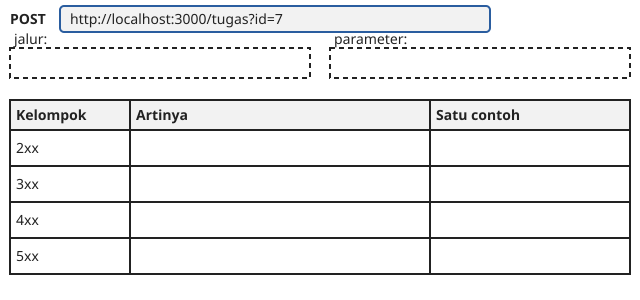

**Ingat dulu:** Dari ingatan, tanpa catatan.

1. Apa itu XSS, dan apa dua cara mencegahnya? ______
2. Apa kode status yang tepat untuk badan permintaan yang tidak lolos skema, dan apa yang sebaiknya dimuat di badan balasan? ______



`[Gambar: atas, POST http://localhost:3000/tugas?id=7 dengan dua kotak kosong berlabel jalur dan parameter. Bawah, tabel kelompok status 2xx, 3xx, 4xx, 5xx dengan kolom Artinya dan Satu contoh kosong.]`

**Prediksi:** `AI: tanpa AI`. Tebak dulu, tulis, baru jalankan.

```ts
const r = new Request("http://localhost:3000/tugas?id=7", {
  method: "POST",
  headers: { "Content-Type": "application/json" },
  body: '{"judul":"belajar"}',
});
const u = new URL(r.url);
console.log(r.method, u.pathname, u.searchParams.get("id"), r.headers.get("content-type"));
```

Apa yang tercetak? ______  Isi kotak jalur dan parameter pada gambar. Bagian mana dari permintaan itu yang berada di badan (body), bukan di alamat? ______

**Lengkapi:** Fungsi pengelompok status.

```ts setengah-jadi
function kelompok(status: number): string {
  if (status >= 200 && status < ____) return "sukses";
  if (status >= 400 && status < ____) return "salah di sisi permintaan";
  return "galat di server";
}
console.log(kelompok(204), kelompok(404), kelompok(503));
```

Apa yang tercetak untuk `kelompok(302)`, dan mengapa itu menyesatkan? ______

**Susun:** Susun baris menjadi `diagnosa` versi ringkas yang benar. Satu baris tidak terpakai.

```text
A.     return "tidak tersambung";
B.   } catch {
C.   try {
D. async function diagnosa(url: string): Promise<string> {
E.     return respons.ok ? "sukses" : `gagal ${respons.status}`;
F.     const respons = await fetch(url, { signal: AbortSignal.timeout(300) });
G.   }
H. }
I.     respons.close();
```

Urutan: ______ , ______ , ______ , ______ , ______ , ______ , ______ , ______ ; tidak terpakai: ______

**Latihan:**

1. `AI: tanpa AI` Tebak apa yang dicetak `new URL("http://localhost:3000/cari?kata=web&hal=2").searchParams.get("hal")`, lalu jalankan: ______
2. `AI: boleh` Tulis lima langkah diagnosis untuk keluhan "daftar tugas tidak muncul di halaman", mulai dari tab Network: apa yang kamu cek, urutannya, dan arti tiap hasil (tidak ada permintaan, 404, 500, 200 tetapi kosong).
3. `AI: tanpa AI` Mengapa galat CORS tidak muncul saat memakai `curl`, dan di sisi mana perbaikannya dilakukan? ______

**Cek diri:**

- [ ] Saya dapat mengelompokkan status 2xx sampai 5xx dan menyebut penyebab khasnya.
- [ ] Saya dapat membedakan galat jaringan (tidak tersambung, waktu habis) dari respons 4xx dan 5xx.
- [ ] Saya tahu menyaring token dan cookie sebelum membagikan tangkapan.

**Catatan cetak (untuk guru, tidak dicetak):** satu sampai dua halaman A4. Kunci ada di modul `b-xi2-m11` bagian "Kunci dan petunjuk". Lembar tidak memuat kolom identitas.
