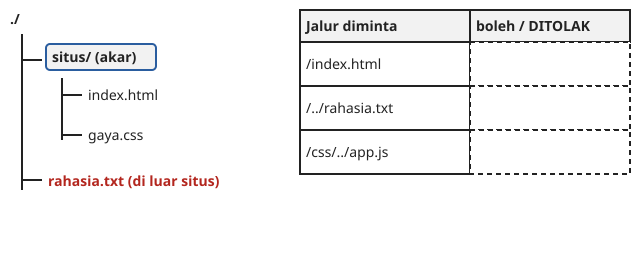

**Ingat dulu:** Dari ingatan, tanpa catatan.

1. Apa arti kelompok status 2xx, 3xx, 4xx, dan 5xx, dengan satu contoh tiap kelompok? ______
2. Mengapa bentuk data dari API luar diperiksa sebelum dipakai? ______



`[Gambar: pohon folder dengan folder situs (akar) berisi index.html dan gaya.css, dan berkas rahasia.txt di luar folder situs. Di kanan, tabel tiga jalur: /index.html, /../rahasia.txt, /css/../app.js, dengan kolom kosong boleh / DITOLAK.]`

**Prediksi:** `AI: tanpa AI`. Tebak dulu, tulis di tabel gambar, baru jalankan.

```ts
import { join, resolve } from "node:path";

const akar = resolve("situs");
for (const minta of ["/index.html", "/../rahasia.txt", "/css/../app.js"]) {
  const berkas = resolve(join(akar, minta));
  console.log(minta, "->", berkas.startsWith(akar + "/") ? "boleh" : "DITOLAK");
}
```

`resolve` menyelesaikan `..` pada jalur. Mengapa pemeriksaan `startsWith(akar + "/")` dilakukan sesudah `resolve`? ______

**Lengkapi:** Penjaga jalur pada server.

```ts setengah-jadi
const berkas = resolve(join(akar, jalur));
if (!berkas.startsWith(akar + "____")) {
  return new Response("ditolak", { status: ____ });
}
```

Apa yang terjadi bila ditulis `startsWith(akar)` tanpa garis miring, dan ada folder `situs-lama` di sebelah `situs`? ______

**Susun:** Susun baris menjadi penanganan permintaan yang benar di dalam `Bun.serve`. Satu baris tidak terpakai.

```text
A.     const isi = Bun.file(berkas);
B.   async fetch(req) {
C.     return new Response(isi);
D.     if (!(await isi.exists())) return new Response("tidak ada", { status: 404 });
E.     const jalur = decodeURIComponent(new URL(req.url).pathname);
F.     if (!berkas.startsWith(akar + "/")) return new Response("ditolak", { status: 403 });
G.     const berkas = resolve(join(akar, jalur));
H.   },
I.     return new Response("kosong");
```

Urutan: ______ , ______ , ______ , ______ , ______ , ______ , ______ , ______ ; tidak terpakai: ______

**Latihan:**

1. `AI: tanpa AI` Tebak apa yang dicetak `new URL("/../rahasia.txt", "http://localhost:3300").pathname`, lalu jalankan. Mengapa penjaga `startsWith` tetap perlu? ______
2. `AI: tanpa AI` Folder `situs` berisi `index.html`, `app.js`, `.env`, `catatan-guru.txt`, dan `app.js.map`. Berkas mana yang aman disajikan dan mana yang harus dikeluarkan, beserta alasannya? ______
3. `AI: boleh` Tambahkan `situs/404.html` dan ubah server agar jawaban 404 memakai isinya, dengan status tetap 404. Uji dengan `curl -i`.
4. `AI: boleh` Jalankan server di `localhost` lalu di `0.0.0.0` (hanya dengan izin gurumu, di jaringan lab). Tulis dua hal yang kamu pastikan sebelum mengubahnya: ______

**Cek diri:**

- [ ] Saya dapat menulis server berkas statis dengan 404 dan jenis isi yang benar.
- [ ] Saya dapat menjelaskan dan menguji penelusuran jalur.
- [ ] Saya tahu kapan memakai `localhost` dan kapan jaringan lab, dan apa yang tidak boleh disajikan.

**Catatan cetak (untuk guru, tidak dicetak):** satu sampai dua halaman A4. Kunci ada di modul `b-xi2-m12` bagian "Kunci dan petunjuk". Lembar tidak memuat kolom identitas.
